# Music Grabber
**v4.2.4 (2026-09-30)**

A self-hosted music acquisition service. Search YouTube, SoundCloud, zvu4no, FreeMp3Cloud, JioSaavn, Monochrome, and optional Soulseek, tap a result and it downloads the best quality audio straight into your music library. You'll have a choice to convert to a common format, or store as is.

If you find it useful, consider buying me a coffee: https://ko-fi.com/geekphreek

## Why?

It started as the "I want one song, not a commitment" tool: Lidarr's great for albums, but grabbing a single track you heard on the radio shouldn't require navigating menus or pulling an artist's entire discography. Search, tap, done; that's still the heart of it.

It has since grown well past that brief. Watched Playlists and Watched Artists keep your library current on their own, checking six playlist platforms plus MusicBrainz for new singles so you don't have to remember to. Multi-source search now reaches proper lossless Monochrome and Soulseek alongside YouTube and SoundCloud; Album mode handles the odd full release; track upgrades, provenance auditing, and multi-user support round out the rest. It's not trying to become Lidarr (see below); it just turns out "grab one song" was the thin end of a much bigger wedge.

## What this project is not

MusicGrabber is intentionally narrow. It is **not**:

- **A full music manager** (not Lidarr, not a replacement for Navidrome/Jellyfin)
- **A back-catalogue hoover** (followed artists can opt in to collecting new albums as they are released, but nothing ever retro-downloads a discography; switching that on marks everything already out as seen)
- **A streaming server/player** (it acquires files; it does not serve or stream your library)
- **A DJ/pro-audio workflow tool** (no Atmos/spatial-audio specialist pipeline)
- **A custom library templating engine** (no advanced token-based naming/structure rules)

## Features

- **Multi-source search:** the Tracks tab searches YouTube, SoundCloud, zvu4no, FreeMp3Cloud, JioSaavn, Monochrome, and optional Soulseek in parallel; relevance-ranked results include source badges and score explanations, plus a separate audio-quality tier where the provider declares one. Soulseek results also show the peer's current queue depth and use it as a bounded ranking penalty, so an idle peer wins an otherwise equal contest without a busy peer disappearing altogether. The single-song search collapses when you leave Tracks, keeping the other workspaces focused on their own jobs
- **Live search progress:** results stream in as each source answers, with live status for completed, slow, parked, or unavailable sources; repeated timeouts automatically bench an unhealthy source until a background probe clears it. yt-dlp searches and metadata lookups share a bounded retry policy for throttling, timeouts, gateway failures, and reduced format manifests, while genuinely private/deleted media fails immediately
- **Monochrome source:** searches Deezer metadata, keeps only results Monochrome's own tracks API actually stocks (matched by ISRC), and downloads the FLAC from it, with a Deezer ISRC rescue and a self-hosted Tidal stream as fallbacks. If Deezer is down, the tracks API is searched directly. Monochrome downloads are 16-bit/44.1kHz FLAC. No account or API key is required. Enabled by default and configurable in Search Sources
- **JioSaavn source:** India's biggest streaming service, asked directly, with no account, token or proxy. Most tracks are 320 kbps AAC (saved as `.m4a`), a few only 160, and results say which before you download. Superb for Bollywood, Punjabi and other Indian music. JioSaavn filters search results by country, so outside India its Western catalogue has gaps; the other sources fill them. Enabled by default and configurable in Search Sources
- **Watched playlists:** monitor Spotify, YouTube (including Mixes), Amazon Music, Apple Music, SoundCloud, Tidal, Beatport, Monochrome, and ListenBrainz playlists; auto-downloads new tracks and grabs the best match available. Per-playlist sync mode: Append (M3U grows as tracks arrive) or Mirror (M3U stays in sync with the upstream; removed tracks drop out). Each card shows live refresh state and stage. "Missing" button shows tracks that never made it; Retry and Search buttons to fix them. M3U updates immediately as each track finishes
- **Artists tab:** follow an artist on MusicBrainz and new singles are downloaded automatically as they appear. Search by name, pick from up to five candidates, set a from-date (defaults to today so your back-catalogue stays put). Singles come first: remixes, live cuts, soundtracks, and compilations are filtered out at the MusicBrainz level. Albums sit underneath for browsing and picking off individually, with an optional "automatically add new albums" toggle that marks everything already released as seen, so ticking it never starts a back-catalogue download. A transient failure while handing a new album to the queue is recorded and retried once on the next artist check rather than making the release permanently “known but abandoned”. Tracks already on disk are recognised immediately, and followed-album labels are derived from the current import and actual audio count rather than preserving “Queued” until the sun burns out. Per-artist check interval, Keep source/Convert to control, pause/resume, missing and track list panels. You can also browse any artist's albums without following them at all
- **Playlist routing:** pick any watched playlist or existing `.m3u` file from the selector below the search bar; downloads land there instead of Singles
- **Playlist housekeeping:** find audio left behind by mirror-mode playlist removals and move it safely into Singles; optionally stamp watched-playlist names into audio Comment tags for macOS Music smart playlists
- **Album mode:** browse MusicBrainz artists from either the Artists tab or Bulk Import, pick a release, download the full album into `Albums/Artist/Album/`, tag tracks with album context, write cover files, and optionally generate an album-local M3U. Equivalent folders and numbered/fuzzy track names inside the configured Albums tree are reused rather than downloaded again. Multi-disc and Various Artists groups choose the most complete official release and keep the canonical release-group credit/title
- **Bulk Import takes almost anything:** playlist URLs, pasted `Artist - Title` lists, MusicBrainz release links, album URLs from Spotify, Apple Music, YouTube Music, Amazon Music, Beatport, Tidal and Monochrome, or simply an album name typed in. Anything recognised as an album is routed through the album pipeline rather than flattened into loose singles. Album search does not need an artist first, so soundtracks and various-artists compilations work; uncertain matches ask which release you meant instead of guessing
- **Split long DJ mixes and compilation uploads into proper tracks:** paste a single YouTube video into the Bulk Import Fetch box and, if it runs over 12 minutes, MusicGrabber offers to cut it up rather than download it as one blob. It never guesses a boundary: it prefers YouTube's own chapters, then a cue sheet hunted out of the description or comments, and otherwise hands you an empty table (or a box to paste your own cue sheet into) to fill in by hand. Either way you get an editable start/end/title/artist preview before a single byte downloads; confirming it downloads the audio once, cuts each segment with ffmpeg, runs the usual integrity check, and tags directly from the table, landing the lot in `Albums/Album Artist/Video Title/` with cover art from the video thumbnail
- **Auto-album routing:** optional setting that files singles and playlist tracks into `Albums/Artist/Album/` when MusicBrainz resolves an album, the same place a full album download goes. Playlists follow their tracks there through the M3U; a watched playlist with M3U generation off keeps its tracks in its own folder, and compilation playlists always stay together. Album downloads ignore routing altogether and land in their own album folder
- **Bulk import:** paste or upload a text file of "Artist - Title" lines; searches enabled sources in parallel, rejects weak recording matches, then walks confident candidates from lossless towards progressively worse lossy formats. A preferred source breaks ties inside the same quality tier; an allowed lossless result still comes first. It can also create a playlist and route files into the Playlists directory or a custom watched-playlist folder. Each run downloads up to two tracks concurrently (inside the global worker limit). Cancel stops untouched work, lets the two active files finish, and keeps completed files and Queue history
- **Similar artist discovery:** hover any result and click Similar to explore related artists, via Deezer first (no account, no key) and ListenBrainz Labs for the ones Deezer has never heard of. Artists already in your library are dropped, since a recommendation you own is not a recommendation. Download the lot in one go with "Download All", optionally saved as a playlist
- **Find New Artists:** the Artists tab's second half works out who you actually listen to (Navidrome play counts if you use it, otherwise what fills your library, otherwise what you have downloaded) and lays out rows of artists like them that you have not got, each row saying why it is there. The rows are drawn at random from the forty artists you play most, weighted towards your favourites, so no two visits give quite the same page. Every suggestion comes with a thirty-second preview, deliberately not their biggest hit, since that is the one you most likely already own. "Grab the lot" takes a whole row as a single playlist. Click any artist's name and their own lookalikes appear as a new row, with a breadcrumb back out, for as long as you care to keep going
- **Apprise notifications:** one URL covers Gotify, ntfy, Discord, Pushover, Slack, and about 50 others. Also supports Telegram webhook and SMTP email
- **Navidrome/Lidarr duplicate heads-up:** searches warn when a track is already known to either library, including when a playlist says `Primary Artist, Guest` but the library quite reasonably files it under `Primary Artist`; Navidrome can also prevent the duplicate download and reuse the existing path for playlist routing
- **Best quality audio:** new installations keep the provider's source format by default. Optional conversion supports FLAC, ALAC/AAC-in-M4A, Opus, or MP3, with quality settings for lossy formats and clear warnings that a larger container cannot resurrect audio already lost in action
- **Track upgrades:** opt-in library scanner flags files below your quality tier
  on the configured interval, follows tagged files moved inside the library, and
  revalidates the original immediately before any safe, recoverable replacement.
  Files whose size and modification time are unchanged since the last pass are
  re-ranked from cached data rather than re-opened and re-hashed, so a settled
  library costs one `stat` per file instead of a full read of every track. Proposals distinguish the quality of the
  downloaded source from the configured stored output, so a lossless source headed
  for Opus, MP3, or AAC is clearly labelled as a lossy converted result
- **Audio Provenance Audit:** a separate read-only scan of the complete configured
  music directory, including Albums and historical files. It distinguishes the
  stored format from recorded acquisition history, explains every classification,
  leaves uncertain lossless-looking files unknown, and exports filtered CSV/JSON
  dry-run reports
- **Loudness normalisation:** optional two-pass EBU R128 normalisation brings lossy web sources to -14 LUFS without touching lossless masters
- **Automatic Music import:** optionally copy each completed download into a mounted macOS Music "Automatically Add to Music" folder
- **Enhanced metadata:** AcoustID audio fingerprinting with MusicBrainz lookups, falling back to source tags. For "Artist - Title" queries, MusicBrainz expected duration is used as a scoring signal at search time, so a 1:41 DJ edit won't outrank the 3:31 original
- **Manual picks remain deliberate, not gullible:** choosing a live version, remix or edit is allowed to disagree with MusicBrainz, but MusicGrabber remembers the duration shown on that exact result and rejects downloaded bytes that are substantially shorter. A valid 30-second CDN preview can no longer dress up as the four-minute track you clicked
- **Synced lyrics:** automatic lyrics fetching from LRClib, saved as `.lrc` files
- **Auto-organise:** `Singles/Artist/Title.flac` (or flat `Singles/Artist - Title.flac` with "Organise by Artist" off). Optional track-number filenames produce `Singles/Artist/01 - Title.flac` when metadata includes a track number, zero-padded so track 10 doesn't jump the queue. Album mode uses `Albums/Artist/Album/Track.flac`
- **Duplicate detection:** local filesystem check plus optional Navidrome Subsonic API check
- **Trash bin:** deleted files move to `/data/.trash/` instead of being permanently removed; restore with one click to skip re-downloading. Restoring a rejected download also marks its failed Queue row completed, because you have chosen that version after all. Files that fail mismatch or duration checks also land in the trash so you can listen before they vanish
- **In-queue playback:** play button on completed queue cards and trashed files for instant preview without leaving the tab
- **Job queue:** track progress, retry failures, re-download or delete files, see metadata provenance, and sort finished history by outcome while live work stays at the top. A search box narrows the queue by artist, title, album or playlist name, and searches the whole job history rather than only the page on screen, so fixing one wrong track out of a 900-track import does not mean paging through the other 899
- **Statistics dashboard:** download counts, success rate, daily chart, top artists, search analytics
- **Release notes modal:** shows once after each update; also accessible from the Settings tab
- **Update notice:** when a newer release is out, a banner above the search box says so, with a link to the changelog. It checks GitLab's public list of release tags at most twice a day and sends nothing about you or your library. Dismiss it and it stays away until the next release; switch it off entirely with Check for Updates in Settings or `UPDATE_CHECK_ENABLED=false`. Builds from `:dev` are always ahead of the latest release, so they never see it
- **Preview:** hover a result for 2 seconds on desktop, or tap Preview on mobile
- **Dark/light theme:** toggle in the header; preference saved per browser
- **Mobile-friendly UI:** designed for quick searches from your phone
- **Settings tab:** configure all integrations via UI; no docker-compose editing required
- **Multi-user support:** create user accounts with role-based access. Admins manage global settings; standard users get their own queue, watched playlists/artists, notifications, and credentials. Peon users get the stripped-back tabs and inherit global conversion/source settings, for when you want "download this song", not "reconfigure the mothership". Single-user installs work exactly as before with no configuration changes
- **Optional API authentication:** protect your instance with an API key
- **YouTube cookie support:** upload browser cookies in Settings to bypass bot detection
- **Spotify cookie support:** upload cookies from `open.spotify.com` to access private playlists, saved albums, and personal library playlists
- **Minimum bitrate enforcement:** optionally reject downloads below a configurable threshold
- **PUID/PGID support:** run as a specific user for correct file ownership on NAS/SMB shares
- **Optional Navidrome/Jellyfin/Lidarr integration:** auto-triggers library rescan after downloads
- **Soulseek integration:** optional slskd support for P2P search and downloads
- **Report/blacklist:** flag bad results from the queue; blacklisted videos and uploaders are suppressed from future searches

## Source format and conversion

MusicGrabber keeps the provider's source format by default. This avoids unnecessary re-encoding and prevents a lossy web download from turning up in a FLAC overcoat pretending it has always summered in the south of France.

If you prefer a uniform library, choose **Convert to** and select FLAC, ALAC, Opus, or MP3. Opus, MP3, and the bitrate-limited AAC-in-M4A choices are lossy; when one is selected the Settings screen warns that converting a lossless source will permanently discard quality. FLAC and true ALAC preserve genuinely lossless input, but converting YouTube, SoundCloud, MP3, AAC, or Opus audio to a lossless container cannot restore information that has already gone missing. Monochrome and Soulseek may provide native lossless files; MusicGrabber records the known source and stored formats separately so the distinction survives the trip into your library.

When the chosen target format is itself lossy, the **Convert lossless sources only** toggle (`CONVERT_LOSSLESS_ONLY`) skips the re-encode for a source that was already lossy: an MP3 or AAC file, or a track already delivered as Opus, is kept exactly as downloaded rather than being hopped into a different lossy codec for no quality gain. Only genuinely lossless sources (FLAC, ALAC, WAV) are converted. Off by default, and irrelevant when the target format is FLAC or true ALAC, since those never had anything to skip.

## Library scans and slow network shares

The playlist destination selector and Stats storage totals refresh in the background.
Watched playlist names and database-backed statistics appear immediately; physical
playlist names and storage figures show a scanning indicator until their first
complete scan finishes. Later requests use the last complete result while refreshing
snapshots older than five minutes. Files added or removed outside MusicGrabber can
therefore take a refresh to appear. Failed refreshes keep the previous result and
show a failure message; reopen the view after at least 30 seconds to retry.
`GET /api/playlists` includes `scan_state` (`refreshing`, `ready`, or `error`)
and `scan_ready`; `GET /api/stats` includes `storage_scan_state`, with
`storage_bytes` and `file_count` set to `null` until a complete result is available.

Duplicate detection checks familiar filenames first, then queries the persistent
library index by Artist and Title, including featured-artist credit variants.
A completed index survives restarts and remains usable while old or being
refreshed. Matches are checked against real files inside the user's library;
a vanished copy does not hide another valid match. No whole-library tag crawl
runs for hits or misses while that root has a usable completed index.

If the index is missing, inaccessible, corrupt or has never completed a scan,
the existing background tag scan remains the fallback. Its last complete
in-memory snapshot is usable immediately; downloads never wait for a build.
During a first build, renamed files may escape duplicate detection until tags
are available. Track Upgrades remains separate and yields to this fallback tag
scan. Switching Track Upgrades off stops its active pass shortly.

The upgrade scan also stopped reading files it has already seen. It used to
re-probe and re-hash every eligible file on every pass, which meant pulling the
entire library across the network once a day to establish that nothing had
happened. A file whose size and modification time both match the previous scan
is now re-ranked against your current quality target from stored data alone, so
only genuinely new or changed files are opened. The stored hash is still
verified against the real file immediately before any replacement, where it
matters and where it costs one read rather than thousands. The trade-off: a
replacement that preserves both size and timestamp exactly will not be noticed
until something else disturbs the file.

Every full-library scan shares one walker, and that walker now reads directory
entries directly rather than asking the filesystem the same questions repeatedly.
A pass over 1,675 files went from 16,475 metadata operations to 2,547, which is
9.84 per file down to 1.52. The scans that benefit are the duplicate tag index,
Track Upgrades, the Stats storage totals and the admin library rebuild. Nothing
about what they find changes; symlinked files and directories are still skipped
and NAS bins are still excluded, so nothing a scan returns can have left the
music root.

The Track Upgrades scan also writes its results in batches rather than saving
after every file, which on a large library removes tens of thousands of database
flushes per pass. A crash mid-batch loses at most that batch; the next scan
rebuilds it from the files themselves.

## Persistent library index

MusicGrabber keeps a persistent index of the audio files beneath each configured
music root: one row per file holding its size, modification time, inode, codec,
bitrate, duration, Artist and Title tags, and whether MusicGrabber downloaded it.
It is stored separately from the main application database, at
`/data/music_grabber_library_index.db` by default (`LIBRARY_INDEX_DB_PATH`).

The index is a cache and nothing more. The filesystem remains the source of
truth. A missing, cold, locked or corrupt index is an unavailable optional hint,
never an error: consumers retain their fallback behaviour. A completed index
remains usable regardless of age or an active refresh. It shares no locks or
transactions with the database holding your jobs, settings and watch lists, so
index work cannot block a download, and if it is ever corrupted the recovery
procedure is to delete the file and let it rebuild. Upgrades that change the
index's shape discard its contents and rebuild them from disk rather than
migrating; a cache has nothing worth migrating, and the disk always knows.

Reconciliation runs once a day per root (`LIBRARY_INDEX_RECONCILE_HOURS`),
starting a few minutes after the other schedulers have settled
(`LIBRARY_INDEX_START_DELAY`). A file whose size and modification time both
match the previous pass is not opened at all. A file that appears at a new path
with a size and timestamp matching one that has vanished is treated as a rename
and keeps everything already known about it, so an external organiser
reorganising the library overnight does not force a full re-read. Only genuinely
new or changed files are opened, and each is opened once.

MusicGrabber's own file changes do not wait for that daily pass. Completing a
download, moving a file to the trash, restoring it, replacing it with an upgrade,
undoing that replacement and correcting tags through the Queue each update the
index on the spot. An arrival is recorded when the job is recorded complete
rather than when the file first lands, because integrity and bitrate checks run
after the move and may still delete it; failed jobs and playlist `.m3u` paths are
not recorded at all. A tag correction replaces the row rather than moving it,
since the file's contents changed and not just its name, and that one matters:
duplicate detection trusts the index's Artist and Title outright, so a stale row
would refuse an unrelated download as a duplicate of a name the file no longer
carries. Each hook is a hint, not a promise. If the index is missing, locked or
corrupt the hook does nothing and the daily reconciliation picks the change up as
it always did.

Files MusicGrabber did not download are indexed too, recorded as not ours. This
is deliberate and is most of the value: on a typical library the great majority
of files were never downloaded by MusicGrabber, and without a row saying so they
are opened on every scan, forever, to rediscover that.

The index is keyed on the library root rather than on the user. A file's size,
codec and tags do not change depending on who is asking, so users sharing a
music root share the rows instead of building an identical copy each. Users with
different roots get different rows, and every lookup still passes its result
through the existing containment check, which is what enforces isolation.

Deletions are published only after a walk that completes successfully. If a walk
returns fewer than half the files the previous complete scan saw
(`LIBRARY_INDEX_DELETE_FLOOR`), the pruning step is refused outright, the reason
is logged and recorded against the root, and the index is left exactly as it was
for the next pass. A half-mounted share or a permissions change on one subtree
must never be published as "the user deleted their library".

A full build of a large library takes a while and logs its progress every 30
seconds (`LIBRARY_INDEX_PROGRESS_SECONDS`) so it can be told apart from a stall.
A reconciliation that finishes inside that window logs nothing.

To force a complete rebuild, stop MusicGrabber, delete
`/data/music_grabber_library_index.db` along with any `-wal` and `-shm` files
beside it, and start it again. The index is derived entirely from the audio on
disk, so nothing is lost; the next reconciliation reads every file once and
builds it back. Do not delete the main database, which is not derived from
anything and is not so forgiving.

Stats storage figures, duplicate tag checks, the Track Upgrades scan and the
admin library rebuild all read from the index, retaining their existing scans as
the fallback for when it cannot answer.

The Track Upgrades scan is the largest beneficiary. Most of a real library was
never downloaded by MusicGrabber and can never become an upgrade candidate, yet
every pass used to open all of it to rediscover that. A row carrying the same
size and nanosecond timestamp now answers instead. Measured on a real library
over SMB, a steady-state pass over 1,673 files went from 33.6 seconds to 2.2,
with 1,287 file reads replaced by index lookups.

## Audio Provenance Audit

Open **Watched → Audio Provenance Audit** and choose **Run Audit**. The scan
walks every supported audio file beneath the configured music directory,
including Singles, Playlists, Albums, and older files MusicGrabber did not
download. Symlinks and known trash, upgrade-quarantine, and acquisition-staging
directories are excluded, as are NAS-generated bins (`@Recycle`, `#recycle`,
`.Trash-1000`, `$RECYCLE.BIN`) and metadata folders (`@eaDir`,
`System Volume Information`, `lost+found`, the macOS Spotlight caches). The
same exclusion list is shared by the track-upgrades scan and the Stats storage
figure, so none of them count files you deleted weeks ago that the NAS has
quietly held on to. Album folders genuinely named *Trash* are unaffected; only
the hidden bin names above are skipped. A new result only becomes current when the whole scan
has completed, so a failed scan cannot replace the last complete report.
Interactive library views take priority over the background reader, so a large
NAS audit waits its turn rather than making the rest of the UI seize up.

The report keeps three ideas separate:

- **Stored format** is what the file is now: its container, codec, observed
  bitrate, sample rate, and bit depth where available.
- **Recorded provenance** comes from MusicGrabber's `SOURCE`,
  `SOURCE_QUALITY`, `SOURCE_CODEC`, and `SOURCE_BITRATE` tags, including the
  older human-readable tag format.
- **Effective quality** is a conservative conclusion from those two sets of
  evidence. A lossy input converted to FLAC remains lossy; a historical FLAC
  with no decisive provenance remains unknown.

Each file is placed in one of these classes:

| Classification | Meaning |
|---|---|
| Known lossy transcode | A lossless codec now stores audio whose recorded acquisition codec was lossy |
| Native lossy acquisition | Both the stored file and recorded acquisition are lossy |
| Lossy derivative of recorded lossless | A lossy file was made from an acquisition recorded as lossless |
| Recorded lossless acquisition | Both stored and acquisition codecs were recorded as lossless |
| Historical or unknown provenance | The available history is missing or too ambiguous for a firmer conclusion |
| Unreadable audio file | The extension is supported but Mutagen could not inspect the file |

“Recorded lossless” is intentionally not called “genuine lossless.” Container,
bitrate, metadata, and spectral analysis cannot prove that a file has never
passed through a lossy encoder. The audit currently performs no spectral
analysis at all; it would only ever be a labelled heuristic, not a promotion
ticket for uncertain files. A 1,000 kbps FLAC can wear a very impressive
waistcoat and still know nothing about its childhood.

Filter by classification, container, codec, acquisition source, effective
quality, or use the two deliberately separate lossless views:

- **Stored in a lossless codec** includes unknown-history lossless-looking files.
- **Recorded lossless acquisition** includes only files whose acquisition
  metadata records a lossless codec.

CSV and JSON exports include the scan version, filters, evidence, caveats, and
an explicit dry-run notice. The audit never renames, retags, moves, deletes, or
replaces audio. It also does not feed anything into Watched Upgrades yet; that
bridge stays out until the report has earned trust with real libraries.

## Screenshots

| Find New Artists | Down the Rabbit Hole |
|:---:|:---:|
| 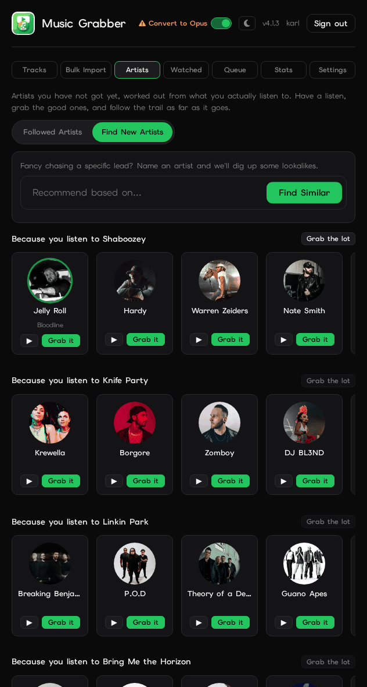 | 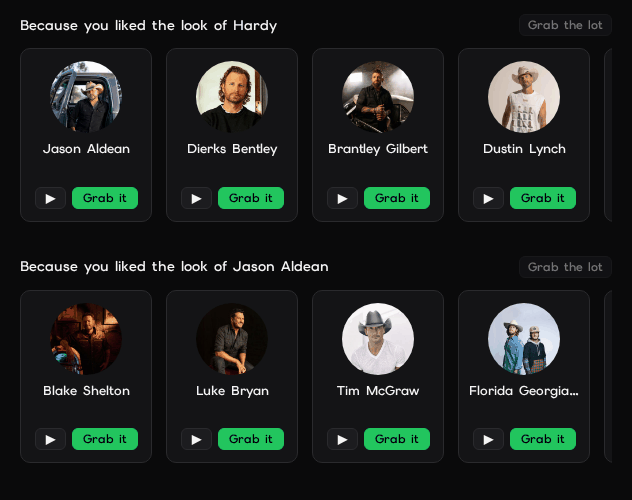 |

| Search & Results | Albums | Queue |
|:---:|:---:|:---:|
| 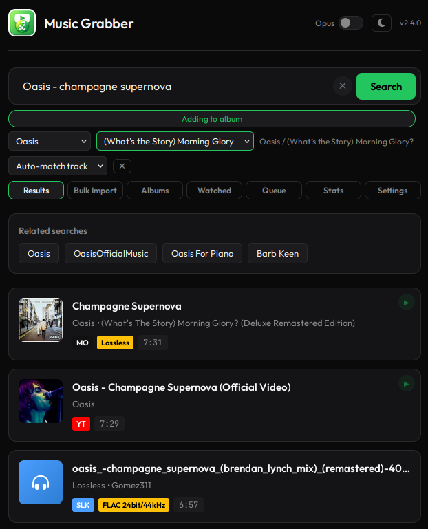 | 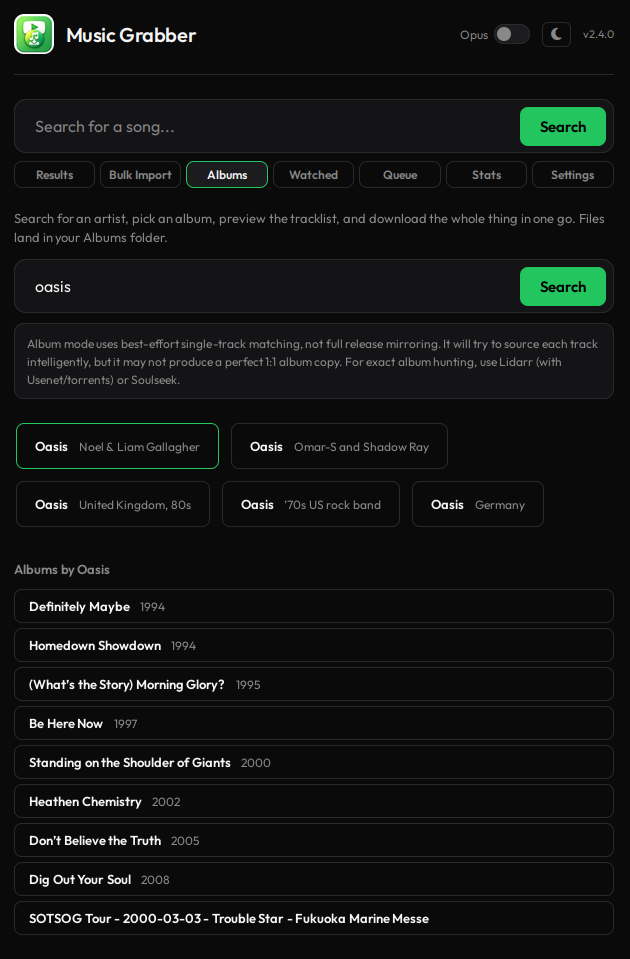 | 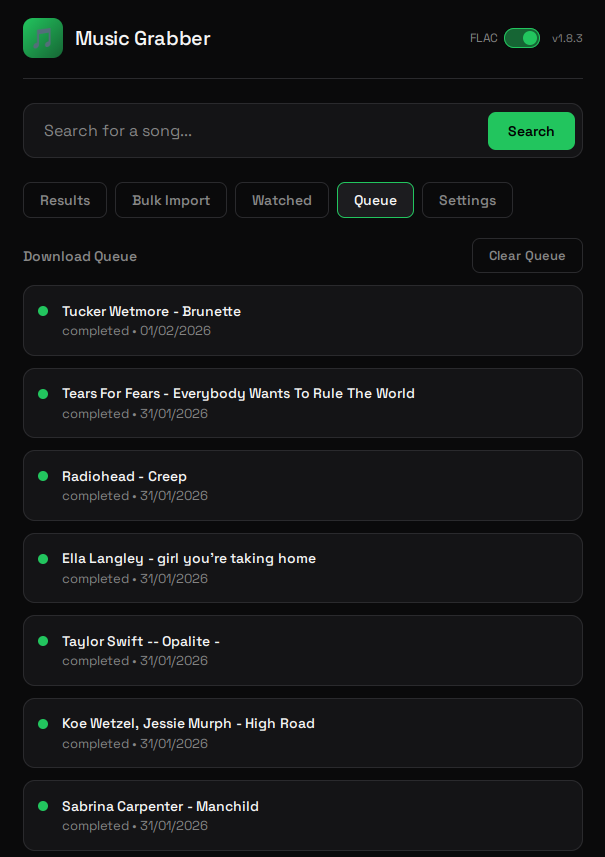 |

| Watched Playlists | Bulk Import | Settings |
|:---:|:---:|:---:|
| 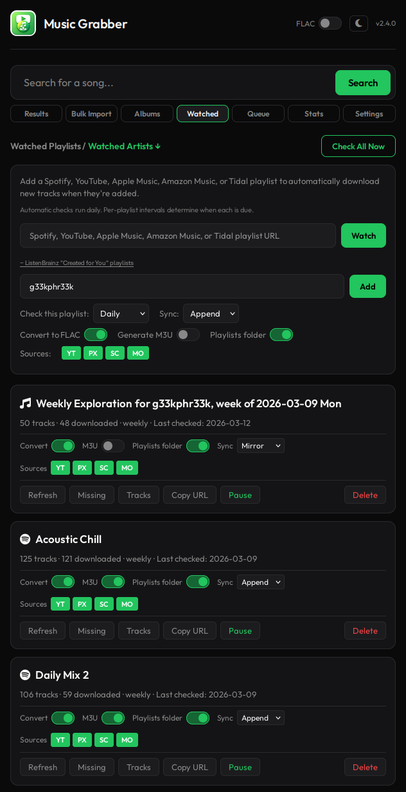 | 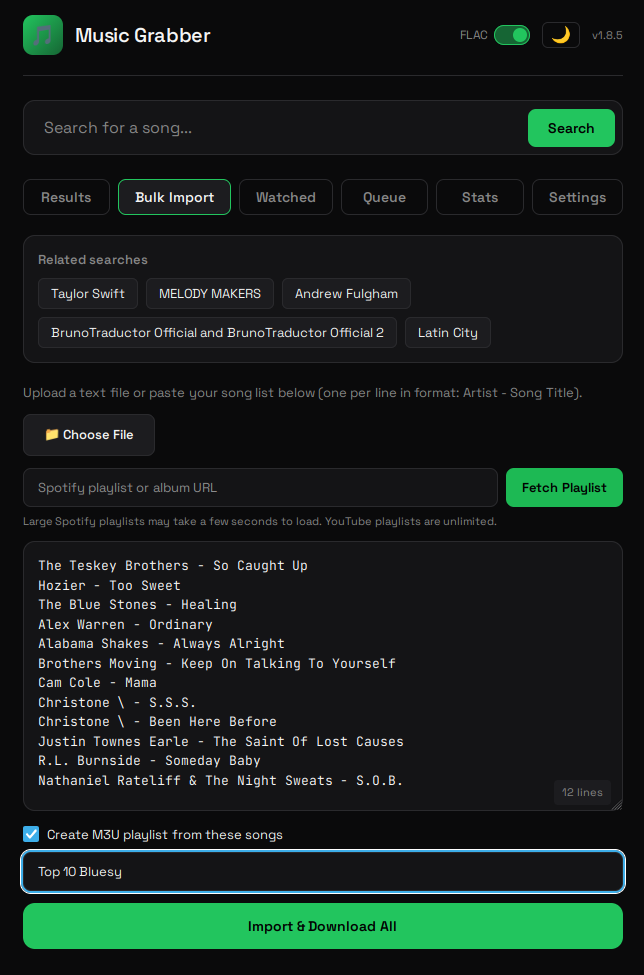 | 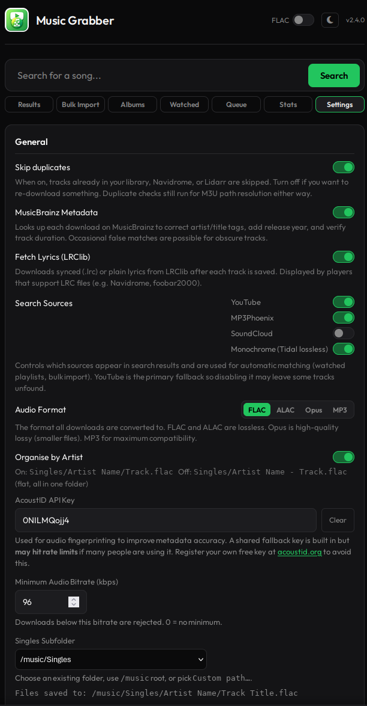 |

| Integrations & Cookies | Notifications | Dark & Light Theme |
|:---:|:---:|:---:|
| 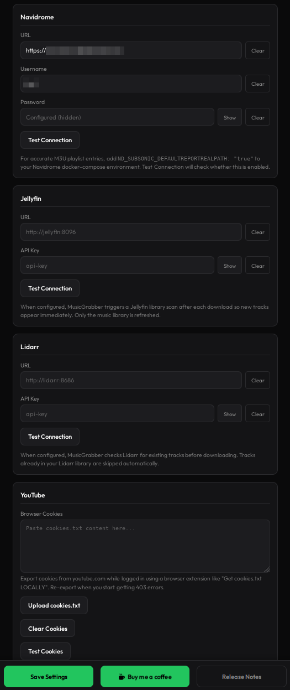 | 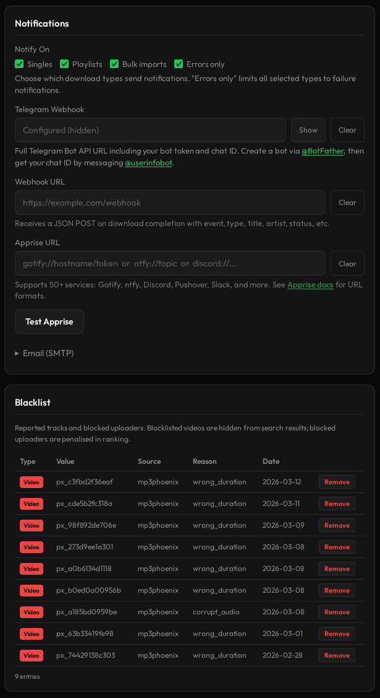 | 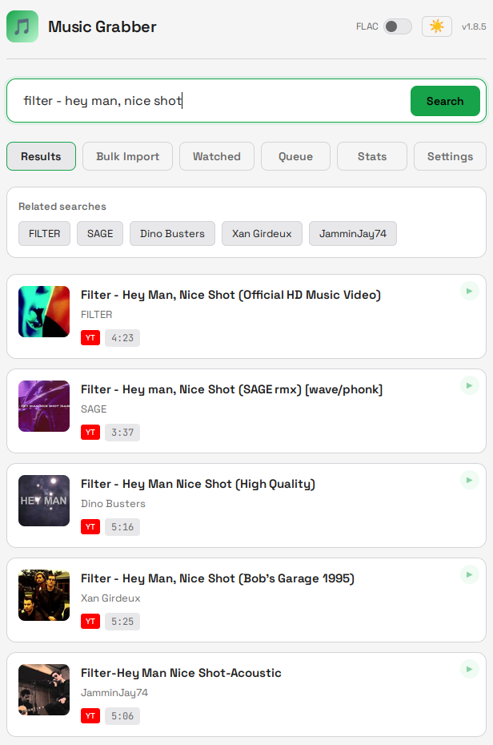 |

## Quick Start

### Option A: Using Docker Hub (Recommended)

1. **Create a docker-compose.yml**
   ```yaml
   services:
     music-grabber:
       image: g33kphr33k/musicgrabber:latest
       container_name: music-grabber
       restart: unless-stopped
       # Required for Spotify playlists over 100 tracks (headless browser)
       shm_size: '2gb'
       ports:
         - "38274:8080"
       volumes:
         - /path/to/your/music:/music
         - ./data:/data
       environment:
         - MUSIC_DIR=/music
         - DB_PATH=/data/music_grabber.db
         # Optional: serve behind a reverse-proxy subpath (proxy must strip the prefix)
         # - ROOT_PATH=/musicgrabber
         - ENABLE_MUSICBRAINZ=true
         # Optional: convert downloads instead of keeping the provider's source format
         # - DEFAULT_CONVERT_TO_FLAC=true
         # Optional: Run as specific user (like *arr stack) for correct file permissions
         # - PUID=1000
         # - PGID=1000
         # Optional: Custom bind address/port (useful for IPv6 or non-standard setups)
         # - LISTEN_ADDR=0.0.0.0
         # - LISTEN_PORT=8080
         # Optional: Navidrome auto-rescan
         # - NAVIDROME_URL=http://navidrome:4533
         # - NAVIDROME_USER=admin
         # - NAVIDROME_PASS=yourpassword
         # Optional: Jellyfin auto-rescan
         # - JELLYFIN_URL=http://jellyfin:8096
         # - JELLYFIN_API_KEY=your-jellyfin-api-key
         # Optional: Plex auto-rescan
         # - PLEX_URL=http://plex:32400
         # - PLEX_TOKEN=your-plex-token
         # Optional: Notifications
         # - NOTIFY_ON=playlists,bulk,errors
         # - TELEGRAM_WEBHOOK_URL=https://api.telegram.org/bot{token}/sendMessage?chat_id={chat_id}
         # - WEBHOOK_URL=https://your-webhook-endpoint.com/hook
         # - SMTP_HOST=smtp.example.com
         # - SMTP_PORT=587
         # - SMTP_USER=user@example.com
         # - SMTP_PASS=password
         # - SMTP_TO=you@example.com
   ```

2. **Run**
   ```bash
   docker compose up -d
   ```

3. **Access the UI** at `http://your-server:38274`

### Option B: Unraid (Community Applications)

If you're running Unraid, the easiest way is via Community Applications. Search for **MusicGrabber** and install directly from Docker Hub.

For manual setup, or if you want a reference for the XML config, here's a working Unraid template:

```xml
<Config Name="Appdata" Target="/data" Default="" Mode="rw" Description="" Type="Path" Display="always" Required="false" Mask="false">/mnt/user/appdata/musicgrabber/</Config>
<Config Name="Music" Target="/music" Default="" Mode="rw" Description="" Type="Path" Display="always" Required="false" Mask="false">/mnt/user/media/music/</Config>
<Config Name="MUSIC_DIR" Target="MUSIC_DIR" Default="" Mode="" Description="" Type="Variable" Display="always" Required="false" Mask="false">/music</Config>
<Config Name="DB_PATH" Target="DB_PATH" Default="" Mode="" Description="" Type="Variable" Display="always" Required="false" Mask="false">/data/music_grabber.db</Config>
<Config Name="ENABLE_MUSICBRAINZ" Target="ENABLE_MUSICBRAINZ" Default="" Mode="" Description="" Type="Variable" Display="always" Required="false" Mask="false">true</Config>
<Config Name="DEFAULT_CONVERT_TO_FLAC" Target="DEFAULT_CONVERT_TO_FLAC" Default="" Mode="" Description="" Type="Variable" Display="always" Required="false" Mask="false">false</Config>
<Config Name="PUID" Target="PUID" Default="" Mode="" Description="" Type="Variable" Display="always" Required="false" Mask="false">99</Config>
<Config Name="PGID" Target="PGID" Default="" Mode="" Description="" Type="Variable" Display="always" Required="false" Mask="false">100</Config>
```

PUID `99` and PGID `100` are Unraid's standard `nobody`/`users`, these give the container correct write access to your shares. Adjust if your setup differs.

### Option C: Build from Source

1. **Clone and configure**
   ```bash
   git clone https://gitlab.com/g33kphr33k/musicgrabber.git
   cd musicgrabber
   ```

2. **Edit docker-compose.yml**

   Update the music volume path and optionally add Navidrome credentials:
   ```yaml
   volumes:
     - /path/to/your/music:/music  # <-- your music directory
     - ./data:/data                # <-- keep the job database
   ```
   ```yaml
   environment:
     - NAVIDROME_URL=http://navidrome:4533
     - NAVIDROME_USER=admin
     - NAVIDROME_PASS=yourpassword
   ```

3. **Build and run**
   ```bash
   docker compose up -d --build
   ```

4. **Access the UI**

   Open `http://your-server:38274` on your phone or browser.

### Option D: Windows 10+ (One-Click Setup)

If you're running Windows and don't want to touch the command line, the `windows/` folder has batch scripts that handle everything for you.

**Requirements:** Windows 10 or later. Docker Desktop will be installed automatically if it isn't already.

1. **Download** the `windows/` folder from the repository (or clone the whole repo)
2. **Right-click `setup.bat`** and select **Run as administrator**

The setup script will:
- Check for Docker Desktop and download/install it if missing (requires a reboot; setup resumes automatically on next login)
- Wait for the Docker engine to finish starting
- Ask where you want your music saved (defaults to `%USERPROFILE%\Music\MusicGrabber`)
- Create a `docker-compose.yml` in `%APPDATA%\MusicGrabber`
- Pull the latest MusicGrabber image
- Optionally start MusicGrabber and open your browser to `http://localhost:38274`

**After setup:**

| Script | What it does |
|--------|-------------|
| `run.bat` | Starts Docker Desktop (if not running) and launches MusicGrabber |
| `stop.bat` | Stops the MusicGrabber container |

Both scripts are copied to `%APPDATA%\MusicGrabber` during setup. You can also put `run.bat` on your Desktop for easy access.

**Configuration:** music is saved to the folder you chose during setup. The database and config live in `%APPDATA%\MusicGrabber`. To change settings after install, edit `%APPDATA%\MusicGrabber\docker-compose.yml` or use the Settings tab in the web UI.

### Option E: Nix (community package)

[rrvsh](https://github.com/rrvsh) maintains a standalone Nix flake at [github.com/rrvsh/musicgrabber-nix](https://github.com/rrvsh/musicgrabber-nix), for `x86_64-linux`, `aarch64-linux`, and `aarch64-darwin`:

```console
nix run github:rrvsh/musicgrabber-nix
```

It is unofficial, so issues with the packaging belong over there, and it is pinned to a specific release, which may lag behind the Docker images. It currently leaves SeleniumBase out, so Amazon Music album naming is unavailable. It listens on `127.0.0.1:8080` by default; see its README for the state and music paths.

## Configuration

### Settings Tab (Recommended)

The easiest way to configure MusicGrabber is via the **Settings tab** in the UI. You can configure:

- **General**: MusicBrainz and Deezer metadata, lyrics fetching, default conversion, minimum bitrate, live-version rejection, and optional loudness normalisation
- **Audio format**: FLAC, ALAC/AAC-in-M4A, Opus, or MP3, including MP3/Opus/ALAC quality presets
- **Library layout**: Singles, Playlists, and Albums subfolders, track-number filenames, auto-album routing, playlist album/comment tagging, automatic Music import, singles-only mode, and file permissions
- **Search sources**: enable/disable YouTube, SoundCloud, zvu4no, FreeMp3Cloud, JioSaavn, Soulseek, and Monochrome; configure cross-source fallback, automatic health checks, and a per-provider search limit from 1–5 (default 1). Soulseek is disabled by default. An off-by-default YouTube playlist option can use the exact upstream video only after every confident alternative fails. Download concurrency remains deliberately internal and conservative
- **Track upgrades**: scan the library for files below the configured quality tier and control the scan interval
- **Monochrome**: a Test Downloads button that proves the whole route end to end
- **Soulseek (slskd)**: enable toggle, URL, credentials, downloads path
- **Navidrome**: URL and credentials for library refresh
- **Jellyfin**: URL and API key for library refresh
- **Lidarr**: URL and API key for library refresh
- **Notifications**: Apprise URL, Telegram webhook, generic webhook URL, and SMTP settings
- **YouTube**: Upload browser cookies for authenticated downloads and playlist fetching, including watched-playlist refreshes. These use your own cookie file when available, falling back to the shared cookie file otherwise. The fallback is deliberately switched off for account-personalised playlists: borrowing another account's jar there would return a confidently authenticated list of somebody else's songs, so a signed-in user gets their own cookies or a clear error. Account-personalised YouTube Music playlists (Discover Mix, My Supermix, Liked Music and friends) require cookies and will not be enumerated without them, because YouTube answers a logged-out request with somebody else's recommendations rather than an error.
- **Maintenance**: preview and remove orphaned watched imports, clear selected Queue-history states, reconcile missing files, or rebuild path records from audio beneath the configured Singles, Playlists, and Albums folders. These actions change database records only; they never delete or move library audio
- **Spotify**: Upload browser cookies to access private playlists
- **Apple Music**: Add a user token for private library playlists
- **Blacklist**: View and manage reported tracks and blocked uploaders
- **Security**: API key for authentication
- **Users** (admin only): create and manage user accounts, reset passwords

Settings are stored in the database and persist across container restarts.

**Environment variable overrides:** If you set a value via environment variable, it takes precedence over the database value and appears as "locked" in the UI.

### Environment Variables

| Variable | Default | Description |
|----------|---------|-------------|
| `PUID` | `0` | User ID for file ownership (like *arr stack); low NAS service IDs such as TrueNAS `568` are supported |
| `PGID` | `0` | Group ID for file ownership (like *arr stack); low NAS service IDs such as TrueNAS `568` are supported |
| `LISTEN_ADDR` | `0.0.0.0` | Bind address for the web service (set `::` for IPv6 environments) |
| `LISTEN_PORT` | `8080` | Bind port for the web service inside the container |
| `MUSIC_DIR` | `/music` | Music library root inside container |
| `DB_PATH` | `/data/music_grabber.db` | SQLite database path |
| `ROOT_PATH` | *(empty)* | URL prefix when serving behind a reverse proxy subpath, e.g. `/musicgrabber`. Your proxy should strip this prefix before forwarding to MusicGrabber |
| `ENABLE_MUSICBRAINZ` | `true` | Enable MusicBrainz metadata lookups |
| `ENABLE_DEEZER_METADATA` | `true` | Fill album details from Deezer when MusicBrainz has no suitable release metadata |
| `ENABLE_LYRICS` | `true` | Enable automatic lyrics fetching from LRClib |
| `UPDATE_CHECK_ENABLED` | `true` | Check GitLab's public release tags (at most twice a day) and show a banner when a newer release is out. `false` means MusicGrabber never asks |
| `ACOUSTID_API_KEY` | *(shared built-in)* | AcoustID API key for audio fingerprinting. A shared key is built in but **may hit rate limits**. Register a free key at [acoustid.org](https://acoustid.org/login) and set it here (or via Settings tab) to avoid sharing quota |
| `DEFAULT_CONVERT_AUDIO` | `false` | Keep the provider's source format by default. Set to `true` to enable conversion to `AUDIO_FORMAT`. Renamed in v4.0.0; the old `DEFAULT_CONVERT_TO_FLAC` still works and never forced FLAC, which is exactly why it was renamed |
| `AUDIO_FORMAT` | `opus` | Output format when conversion is enabled: `flac`, `alac`, `opus`, or `mp3` |
| `MP3_BITRATE` | `v2` | MP3 quality preset: `v2`, `v0`, `320k`, `256k`, `192k`, or `128k` |
| `OPUS_BITRATE` | `256k` | Opus bitrate: `256k`, `192k`, `128k`, or `96k` |
| `ALAC_BITRATE` | `lossless` | ALAC/M4A quality: `lossless` for true ALAC, or `320k`, `256k`, `192k`, `128k` for AAC-in-M4A |
| `CONVERT_LOSSLESS_ONLY` | `false` | When conversion is enabled and the target format is lossy (Opus, MP3, or AAC-in-M4A ALAC), only re-encode lossless sources (FLAC/ALAC/WAV). A source that's already lossy is kept as delivered instead of being re-encoded into a different lossy format |
| `MIN_AUDIO_BITRATE` | `0` | Minimum audio bitrate in kbps. Downloads below this are rejected. 0 = disabled. Lossless (FLAC) always passes |
| `REJECT_LIVE_VERSIONS` | `false` | Reject a confidently identified live recording when the query did not request one |
| `REJECT_VERSION_KEYWORDS` | - | Comma-separated versions to reject, e.g. `demo, acoustic, radio edit, remix` |
| `NORMALISE_LOSSY_AUDIO` | `false` | Apply two-pass EBU R128 loudness normalisation to lossy web sources; lossless sources are untouched |
| `ENABLE_REPLAYGAIN` | `false` | Write ReplayGain 2.0 track gain/peak tags on new downloads. Tags only, the audio is never re-encoded. Album gain and peak are added once every track of an album has landed |
| `REPLAYGAIN_REPLACE_EXISTING` | `false` | Overwrite ReplayGain tags a file already carries. Off by default; existing tags are assumed to be deliberate |
| `REPLAYGAIN_REFERENCE_LUFS` | `-18.0` | ReplayGain reference loudness. The 2.0 spec's value; changing it makes your library disagree with everyone else's |
| `AUTO_IMPORT_DIR` | *(empty)* | Copy completed downloads into this directory, such as macOS Music's Automatically Add folder |
| `PLAYLIST_COMMENT_TAGGING` | `false` | Write watched-playlist names into each track's Comment tag |
| `ENABLE_TRACK_UPGRADES` | `false` | Enable scanning for library files below the configured output quality tier |
| `UPGRADE_SCAN_INTERVAL_HOURS` | `24` | Hours between automatic track-upgrade scans |
| `SINGLES_SUBDIR` | `Singles` | Subfolder under `MUSIC_DIR` for normal single-track downloads. Use `.` for the music root |
| `PLAYLISTS_SUBDIR` | *(empty)* | Optional subfolder under `MUSIC_DIR` for playlist-routed downloads. Empty means playlist files use the Singles layout |
| `ALBUMS_SUBDIR` | `Albums` | Subfolder under `MUSIC_DIR` for album-mode downloads. Use `.` for the music root |
| `ORGANISE_BY_ARTIST` | `true` | Create artist subfolders under Singles. Set to `false` for a flat directory |
| `INCLUDE_TRACK_NUMBER_IN_FILENAME` | `false` | Prefix saved filenames with the resolved, zero-padded track number when one is available, e.g. `Singles/Artist/01 - Title.flac` |
| `AUTO_ALBUM_SINGLES` | `false` | If MusicBrainz finds album context for a single or playlist track, move it into `Albums/Artist/Album/` automatically. Playlist tracks only move when the playlist keeps an M3U |
| `PLAYLIST_ALBUM_AS_NAME` | `false` | Tag playlist-routed tracks as one compilation using the playlist name as the album |
| `SINGLES_ONLY_MODE` | `false` | Hide the album browsing surfaces (Artists and Bulk Import) while keeping single-track auto-album routing available |
| `FILE_PERMISSIONS` | `666` | File mode applied after downloads. `777` is available for stubborn NAS/share setups |
| `SKIP_DUPES` | `true` | Skip downloads when a matching local file is already found |
| `NAVIDROME_DUPE_CHECK` | `true` | Use Navidrome/Subsonic as part of duplicate detection when Navidrome is configured |
| `WEBHOOK_URL` | - | Generic webhook URL; receives JSON POST on download completion/failure |
| `YTDLP_PLAYER_CLIENT` | *(empty)* | Override yt-dlp YouTube player client (expert-only, e.g. `android`, `web,android`) |
| `YTDLP_AUTO_UPDATE` | `true` | Update yt-dlp when the container starts. Bounded to 45s and never fatal; set `false` to pin whatever the image shipped |
| `YOUTUBE_BOT_BACKOFF_MIN` | `5` | Minimum backoff in seconds before retrying after YouTube bot-detection style failures |
| `YOUTUBE_BOT_BACKOFF_MAX` | `20` | Maximum backoff in seconds before retrying after YouTube bot-detection style failures |
| `YOUTUBE_REQUESTED_VIDEO_FALLBACK` | `false` | After confident alternatives fail for a YouTube playlist track, permit the exact upstream video as the final fallback |
| `NAVIDROME_URL` | - | Navidrome server URL (e.g., `http://navidrome:4533`) |
| `NAVIDROME_USER` | - | Navidrome username for API |
| `NAVIDROME_PASS` | - | Navidrome password for API |
| `JELLYFIN_URL` | - | Jellyfin server URL (e.g., `http://jellyfin:8096`) |
| `JELLYFIN_API_KEY` | - | Jellyfin API key for library refresh |
| `PLEX_URL` | - | Plex server URL (e.g., `http://plex:32400`) |
| `PLEX_TOKEN` | - | Plex authentication token for library refresh |
| `LIDARR_URL` | - | Lidarr server URL |
| `LIDARR_API_KEY` | - | Lidarr API key for library refresh |
| `SOURCE_YOUTUBE_ENABLED` | `true` | Enable YouTube search results |
| `SOURCE_SOUNDCLOUD_ENABLED` | `true` | Enable SoundCloud search results |
| `SOURCE_ZVU4NO_ENABLED` | `true` | Enable zvu4no search results |
| `SOURCE_FREEMP3CLOUD_ENABLED` | `true` | Enable FreeMp3Cloud search results |
| `SOURCE_JIOSAAVN_ENABLED` | `true` | Enable JioSaavn search results (320 kbps AAC, strongest on Indian music) |
| `SOURCE_SOULSEEK_ENABLED` | `false` | Enable Soulseek/slskd search results. Credentials alone do not enable Soulseek |
| `SOURCE_MONOCHROME_ENABLED` | `true` | Enable Monochrome search results |
| `SOURCE_OFFLINE_FALLBACK` | `true` | Try another enabled source after a download source fails; watched-playlist and bulk-import source allow-lists are still enforced |
| `SOURCE_HEALTH_CHECKS_ENABLED` | `true` | Hide unhealthy sources until a background probe confirms recovery |
| `SOURCE_HEALTH_CHECK_INTERVAL_MINUTES` | `10` | Minutes between scheduled source health probes |
| `SOURCE_HEALTH_COOLDOWN_MINUTES` | `10` | Minimum time a failed source remains parked before it can be probed again |
| `SEARCH_CONCURRENCY` | `1` | Maximum simultaneous searches admitted per provider, from 1 to 5. This does not increase download concurrency |
| `MONOCHROME_WEB_URL` | `https://monochrome.st` | Monochrome web client, read to discover where its tracks API currently lives. A retired domain's redirect is followed automatically |
| `MONOCHROME_TRACKS_API_URL` | *(blank)* | Pin the Monochrome tracks API address and skip discovery. Only needed if Monochrome moves and discovery cannot follow; blank uses what the web client says, falling back to `https://tracks.monochrome.st` |
| `SLSKD_URL` | - | slskd API URL (e.g., `http://slskd:5030`) |
| `SLSKD_USER` | - | slskd username |
| `SLSKD_PASS` | - | slskd password |
| `SLSKD_DOWNLOADS_PATH` | - | Path where slskd downloads are accessible (required for Soulseek downloads) |
| `SLSKD_REQUIRE_FREE_SLOT` | `true` | Only show Soulseek results from users with free upload slots |
| `SLSKD_MAX_RETRIES` | `5` | Max retry attempts for failed Soulseek downloads |
| `SLSKD_MATCH_CONFIDENCE_FLOOR` | `0.55` | Minimum Soulseek filename/path match confidence from `0.0` to `1.0`; lower values allow looser matches |
| `WATCHED_PLAYLIST_CHECK_HOURS` | `24` | Maximum time between scheduler sweeps. Shorter per-playlist/per-artist intervals wake sooner; `0` disables automatic checks |
| `WATCHED_HISTORY_RECHECK_HOURS` | `24` | Minimum interval before retrying unresolved append-mode tracks that have left the upstream playlist |
| `WATCHED_REFRESH_STALE_SECONDS` | `1800` | How long before a stuck `running` refresh is auto-failed (seconds) |
| `LIBRARY_RECONCILE_INTERVAL` | `1800` | How often MusicGrabber reconciles deleted/renamed files against the job database (seconds) |
| `SPOTIFY_BROWSER_TIMEOUT_SECONDS` | `180` | Maximum runtime for the headless Spotify playlist browser fallback |
| `SPOTIFY_BROWSER_STALL_SECONDS` | `30` | Abort Spotify browser scrolling after this many seconds without finding more tracks |
| `APPLE_MUSIC_USER_TOKEN` | - | Apple Music user token for private `music.apple.com/library/...` playlists |
| `NOTIFY_ON` | `playlists,bulk,errors` | Notification triggers (applies to all channels): `singles`, `playlists`, `bulk`, `errors` |
| `APPRISE_URL` | - | Apprise notification URL (covers Gotify, ntfy, Discord, Pushover, Slack, and ~50 others) |
| `TELEGRAM_WEBHOOK_URL` | - | Full Telegram webhook URL (see Notifications section below) |
| `SMTP_HOST` | - | SMTP server hostname |
| `SMTP_PORT` | `587` | SMTP server port |
| `SMTP_USER` | - | SMTP username |
| `SMTP_PASS` | - | SMTP password |
| `SMTP_FROM` | - | From address (defaults to SMTP_USER) |
| `SMTP_TO` | - | Recipient address(es), comma-separated |
| `SMTP_TLS` | `true` | Use STARTTLS |
| `API_KEY` | - | API key for authentication (see Security section) |
| `HTTPS_ONLY` | `false` | Reject non-HTTPS API requests. Useful behind a correctly configured reverse proxy |
| `HSTS_MAX_AGE` | `31536000` | HSTS max-age sent on HTTPS responses |
| `ALLOW_API_KEY_QUERY_PARAM` | `false` | Allow `?api_key=` fallback for legacy scripts. Prefer headers unless you enjoy secrets in logs |
| `LOGIN_MAX_ATTEMPTS` | `5` | Failed login attempts before temporary lockout |
| `LOGIN_LOCKOUT_SECONDS` | `900` | Login lockout duration |
| `LOGIN_ATTEMPT_WINDOW` | `900` | Window for counting failed logins |
| `DOWNLOAD_TOKEN_TTL_SECONDS` | `60` | Single-use browser download token lifetime |
| `MAX_CONCURRENT_DOWNLOADS` | `3` | Internal bulk/watched download-worker limit. Kept out of the normal Settings UI to discourage accidental provider hammering |
| `SEARCH_ALL_DEADLINE` | `30` | Maximum collection time for one multi-source search before slow sources are left behind. Per-provider admission is bounded by `SEARCH_CONCURRENCY`, so abandoned calls cannot stack without limit |
| `TIMEOUT_YTDLP_DOWNLOAD` | `300` | Timeout in seconds for yt-dlp to download a single track. Increase for long mixes or slow connections |
| `TIMEOUT_YTDLP_PREVIEW` | `30` | Timeout in seconds for resolving a preview URL. YouTube's player challenge is solved via Deno and can be slow when the answer is not cached |
| `TIMEOUT_FFMPEG_CONVERT` | `120` | Timeout in seconds for ffmpeg format conversion. Increase if long tracks are producing broken files |
| `TIMEOUT_ZVU4NO_DOWNLOAD` | `120` | Timeout in seconds for zvu4no direct MP3 downloads |
| `TIMEOUT_FREEMP3CLOUD_DOWNLOAD` | `120` | Timeout in seconds for FreeMp3Cloud direct MP3 downloads |
| `TIMEOUT_JIOSAAVN_DOWNLOAD` | `120` | Timeout in seconds for JioSaavn direct AAC downloads |
| `TIMEOUT_MONOCHROME_DOWNLOAD` | `300` | Timeout in seconds for Monochrome FLAC downloads |

### Navidrome Integration

To enable Navidrome auto-rescan and duplicate detection, add your credentials:

```yaml
environment:
  - NAVIDROME_URL=http://navidrome:4533
  - NAVIDROME_USER=admin
  - NAVIDROME_PASS=yourpassword
```

If running on the same Docker network as Navidrome, use the container name as the hostname.

**For accurate M3U playlist entries**, also add this to your **Navidrome** docker-compose:

```yaml
environment:
  ND_SUBSONIC_DEFAULTREPORTREALPATH: "true"
```

By default, Navidrome's API returns synthetic paths (`Artist/Album/01-Track.mp3`) rather than real filesystem paths. This env var makes it return actual absolute paths, which MusicGrabber needs to correctly populate M3U playlists when a track is found in Navidrome rather than downloaded fresh. The Settings > Navidrome "Test Connection" button will warn you if this isn't set.

### Jellyfin Auto-Rescan

To automatically trigger a Jellyfin library scan after downloads:

```yaml
environment:
  - JELLYFIN_URL=http://jellyfin:8096
  - JELLYFIN_API_KEY=your-api-key-here
```

Get your API key from Jellyfin: Dashboard, API Keys, Add.

MusicGrabber uses Jellyfin's current `Authorization: MediaBrowser` token header,
which works with Jellyfin 12 and older supported releases. Jellyfin 12 disables
the deprecated `X-Emby-Token` method by default; MusicGrabber does not require
legacy authorization to be enabled, nor does an existing API key need replacing.

### Plex Auto-Rescan

To automatically trigger a Plex library scan after downloads:

```yaml
environment:
  - PLEX_URL=http://plex:32400
  - PLEX_TOKEN=your-plex-token-here
```

Get your token via Plex's own "Finding an authentication token" support article. Plex scopes rescans to a library section rather than the whole server, so MusicGrabber asks Plex which sections exist and refreshes every one it finds tagged as a music library; no separate section ID setting is needed.

### Lidarr Auto-Rescan

MusicGrabber can also poke Lidarr after downloads so it notices new files sooner:

```yaml
environment:
  - LIDARR_URL=http://lidarr:8686
  - LIDARR_API_KEY=your-api-key-here
```

This is a refresh nudge, not a promise that Lidarr will suddenly become reasonable about singles. We can hope, though.

### Monochrome Source (Optional)

Monochrome is enabled by default. MusicGrabber searches Deezer and uses the ISRC to pin down the exact recording. Downloads go through Monochrome's own tracks API, the same one its web player uses: a plain HTTP catalogue with no account, token or browser involved. MusicGrabber searches it by artist and title, keeps only the result carrying exactly the right ISRC, and downloads the FLAC directly. The same check runs at search time, so Monochrome only offers what it can actually deliver; if the tracks API cannot be reached, results are still shown but marked unverified. When Deezer comes back light, unconvincing or empty, the tracks API is searched directly to top it up. At download time, a miss gets an ISRC rescue through Deezer and a second try with the corrected ISRC.

Monochrome downloads are 16-bit/44.1kHz FLAC. The tracks API ignores requests for anything higher, so 24-bit hi-res is not on offer from this source.

Monochrome has changed domain and playback route several times. MusicGrabber reads the tracks API's address from Monochrome's web client (following the redirect a retired domain leaves behind) and re-checks every six hours, so a move should be picked up on its own. If it is not, the Settings test says so, and `MONOCHROME_TRACKS_API_URL` pins the new address by hand.

You can turn it off in Settings, Search Sources, or use:

```yaml
environment:
  - SOURCE_MONOCHROME_ENABLED=false
```

Monochrome results without an ISRC are ignored, because the playback services cannot resolve them and pretending otherwise just wastes everyone's afternoon.

### Notifications (Optional)

Get notified when downloads complete or fail via Telegram, email, or a generic webhook. Configure one or more channels; the same triggers apply to all.

**Notification triggers** (`NOTIFY_ON`):

| Value | Description |
|-------|-------------|
| `singles` | Notify for each individual track download |
| `playlists` | Notify when playlist downloads complete |
| `bulk` | Notify when bulk imports complete |
| `errors` | Notify when any download fails |

Default is `playlists,bulk,errors`: notifications for playlist/bulk completions and any failures, but not for every single track.

**Telegram setup:**

1. Create a bot via [@BotFather](https://t.me/BotFather) and copy the token
2. Get your chat ID by messaging [@userinfobot](https://t.me/userinfobot)
3. Build the webhook URL:

```yaml
environment:
  - NOTIFY_ON=playlists,bulk,errors
  - TELEGRAM_WEBHOOK_URL=https://api.telegram.org/bot{token}/sendMessage?chat_id={chat_id}
```

**Email setup (SMTP):**

```yaml
environment:
  - NOTIFY_ON=playlists,bulk,errors
  - SMTP_HOST=smtp.example.com
  - SMTP_PORT=587
  - SMTP_USER=user@example.com
  - SMTP_PASS=password
  - SMTP_FROM=musicgrabber@example.com
  - SMTP_TO=you@example.com
  - SMTP_TLS=true
```

`SMTP_TO` can be a comma-separated list for multiple recipients. `SMTP_TLS=true`
means STARTTLS, normally on port 587; implicit TLS on port 465 is not supported.
The Settings page can send a test email using the values currently in the form
and reports connection, STARTTLS, authentication, sender, and recipient failures.

**Generic webhook:**

Set `WEBHOOK_URL` to any URL. MusicGrabber sends a JSON POST with event type, title, artist, status, source, and track counts. Useful for custom integrations (Discord bots, Home Assistant, etc.).

```yaml
environment:
  - WEBHOOK_URL=https://your-endpoint.com/hook
```

### Soulseek Integration (Optional)

MusicGrabber can search [slskd](https://github.com/slskd/slskd) (a Soulseek daemon) for higher quality sources. When enabled, search results from YouTube and Soulseek are shown together, ranked by relevance. Soulseek's declared codec and bitrate contribute to that rank and also feed the separate minimum-quality filter, so a good FLAC match still receives its due without pretending audio quality and title relevance are the same measurement. The peer's `queueLength` is shown on the card and applies a small capped rank penalty; it is never an exclusion rule, so a busy peer holding the only good copy remains available. The peer remains visible as the source of the download but is kept separate from the artist. Filename format decorations such as `[FLAC]`, `[1733 kbps]`, and `[16-44]` are removed from displayed titles, full release dates are parsed as one value, and bracketed artist shelf labels are matched against the artist that was searched. Bulk and watched-playlist jobs check their known artist/title against the local library, Navidrome, and Lidarr before asking a Soulseek peer for any bytes. A search result may still initially infer an artist from the remote path; after download, MusicGrabber validates the file in private staging and prefers its embedded `ARTIST` tag before metadata lookup, tagging, a second safety-net duplicate check, or choosing the library folder. Untagged files fall back to the path guess, since even a folder called `Music (FLAC)` is occasionally all the evidence the internet has volunteered.

Soulseek is disabled by default. Turn it on in Settings under Search Sources, or set `SOURCE_SOULSEEK_ENABLED=true`. Entering credentials alone does not enable it.

**Searching only** (no downloads): Just the API credentials are needed to see Soulseek results without downloading anything:

```yaml
environment:
  - SOURCE_SOULSEEK_ENABLED=true
  - SLSKD_URL=http://slskd:5030
  - SLSKD_USER=your-slskd-username
  - SLSKD_PASS=your-slskd-password
```

**Full integration** (search + download): This is where most people get tripped up, so here is the plain English version of what needs to happen.

When slskd finishes downloading a track, it saves it to a folder on your server. MusicGrabber needs to be able to see that same folder so it can pick the file up, validate it, and copy the finished version into your music library. The two applications are separate Docker containers, so they cannot see each other's files by default. You have to give them both access to the same staging folder on your server.

You do that by adding the same folder to the `volumes:` section of **both** containers in your `docker-compose.yml`. The path on the **left** of the `:` is the folder on your server. The path on the **right** is where that folder appears inside the container. The right-hand path must be the same in both containers.

Keep the three jobs in separate host directories:

- `/srv/music` is the finished library.
- `/srv/slskd/downloads` is temporary, unverified acquisition staging.
- `/srv/slskd/shares` contains only files you have deliberately chosen to share.

Do **not** put the downloads directory inside the slskd shares directory or configure it as a share. A Soulseek filename or `.flac` extension is a claim from a stranger on the internet, not a sworn affidavit. MusicGrabber only validates the file after slskd has downloaded it.

Here is a complete safe-layout example. Both containers see the staging directory as `/downloads`, but MusicGrabber receives read-only access to slskd's copy:

```yaml
services:
  slskd:
    image: slskd/slskd
    volumes:
      - /srv/slskd/downloads:/downloads
      - /srv/slskd/shares:/shares:ro
    environment:
      - SLSKD_DOWNLOADS_DIR=/downloads    # tell slskd to save completed files here

  musicgrabber:
    image: g33kphr33k/musicgrabber:latest
    volumes:
      - /srv/music:/music
      - /srv/slskd/downloads:/downloads:ro
    environment:
      - MUSIC_DIR=/music
      - SOURCE_SOULSEEK_ENABLED=true
      - SLSKD_URL=http://slskd:5030
      - SLSKD_USER=your-slskd-username
      - SLSKD_PASS=your-slskd-password
      - SLSKD_DOWNLOADS_PATH=/downloads   # must match the right-hand path above
```

The right-hand paths (`:/downloads`) match, so both containers are looking at the same staging folder. `SLSKD_DOWNLOADS_PATH` tells MusicGrabber where to find it. MusicGrabber copies the chosen file into `/music`, then performs its integrity, conversion, and metadata work there; the unverified staging copy is never part of the library or the deliberate share. You can set the downloads path in the MusicGrabber Settings tab instead of using the environment variable.

**If slskd runs on a different machine**, expose only its downloads directory over NFS or SMB and mount that read-only in MusicGrabber. Keep the slskd share directories separate and unmounted.

**Note:** Soulseek is a P2P network. Most users run slskd behind a VPN. This integration only talks to your slskd instance; it does not connect directly to the Soulseek network. New accounts may see rejected downloads until they build reputation by sharing files.

### Playlist Import

MusicGrabber can import tracks from Spotify, Apple Music, Amazon Music, YouTube, SoundCloud, Tidal, Beatport, Monochrome, and ListenBrainz playlists. Paste a supported URL in the Bulk Import tab to fetch the track list, then import them via the enabled search sources.

Bulk Import also accepts **MusicBrainz release URLs**, which are handled differently: rather than filling the track list, they queue the release straight down the album pipeline. See *MusicBrainz album URLs* below.

**How it works by source:**

- **Apple Music**: Fetches the public page, extracts Apple's current web MusicKit token from the site bundle, then paginates their `amp-api` track endpoint directly. Falls back to the server-rendered HTML when needed
- **Amazon Music**: Playwright bootstraps Amazon's anonymous web session, then reads the complete ordered playlist from the app's JSON response. This avoids the rendered page's virtualised scrolling on long playlists; DOM scraping remains as a fallback
- **Spotify small playlists (under ~100 tracks)**: Uses Spotify's embed endpoint to quickly fetch track data
- **Spotify large playlists (100+ tracks)**: Automatically falls back to headless browser scraping
- **Tidal playlists**: Direct scrape of Tidal's embed player (`embed.tidal.com/playlists/UUID`), which server-renders the full track list. Downloads can use any enabled source
- **Beatport playlists**: Top 100, genre charts, and editorial charts read straight from the page's server-rendered JSON. Folder names are derived from the URL (`/top-100` becomes "Beatport Top 100", `/genre/techno/6/top-100` becomes "Techno Top 100")
- **Monochrome playlists**: Public `monochrome.tf/playlist/...` URLs carry a Tidal playlist UUID, so they are read through Tidal's embed player exactly like a Tidal link

**MusicBrainz album URLs:**

Paste a `https://musicbrainz.org/release/<mbid>` or `https://musicbrainz.org/release-group/<mbid>` link into the Bulk Import URL box and MusicGrabber queues it as a proper album download rather than a flat track list. Files land in `Albums/Artist/Album/` with cover art, an `.albuminfo` sidecar, and track numbers from the release itself; tracks you already own are skipped.

The MBID is already in the URL, so there is no scraping and no fuzzy matching to get wrong. Release-group URLs (what MusicBrainz search links to) are resolved to the earliest official pressing in the group. If "Create playlist" is ticked, the album M3U name comes from the playlist name field.

**Streaming service album URLs:**

Album links from Spotify, Apple Music, YouTube Music (the auto-generated `OLAK5uy_` album playlists), Amazon Music, Beatport releases, Tidal and Monochrome are recognised too, and go down the same album pipeline. Unlike a MusicBrainz link there is no MBID in the URL, so MusicGrabber reads the artist and album name off the page and matches that against MusicBrainz behind a confidence gate: a clear winner downloads, anything doubtful asks which release you meant rather than guessing. The tracklist always comes from MusicBrainz, never the streaming service, so all a service has to do is name the record.

Amazon is the awkward one and needs a real browser to answer at all, so an Amazon album link takes a few seconds longer than the rest. An album Amazon will not serve, whether delisted, region-locked or just a wrong link, fails honestly rather than matching the wrong record.

**Spotify private playlists and personal library:**

By default, only public Spotify content is accessible. To unlock private playlists, liked songs playlists, and anything else that requires a login, upload your Spotify browser cookies in **Settings, Spotify**.

1. Install a cookie export extension such as [Get cookies.txt LOCALLY](https://chrome.google.com/webstore/detail/get-cookiestxt-locally/cclelndahbckbenkjhflpdbgdldlbecc) (Chrome) or [cookies.txt](https://addons.mozilla.org/en-US/firefox/addon/cookies-txt/) (Firefox)
2. Log in to [open.spotify.com](https://open.spotify.com) in your browser
3. Use the extension to export cookies for `open.spotify.com` as a `cookies.txt` file (Netscape format)
4. In MusicGrabber, go to **Settings, Spotify**, click **Upload cookies.txt**, and select the file
5. Click **Test Cookies** to confirm the session is active
6. Private playlist URLs will now work in Bulk Import and Watched Playlists

The `sp_dc` session cookie is what grants access. It has a long expiry (typically ~1 year) but will be invalidated if you log out of Spotify or change your password. If a private playlist suddenly returns an error, your cookies have expired, re-export and paste them in. MusicGrabber will show an amber warning banner in Settings when it detects the cookies have stopped working.

**Apple Music private library playlists:**

Public Apple Music playlists and albums work without credentials, at any length. Only private `music.apple.com/library/...` playlists need your Apple Music user token: add it in **Settings, Apple Music**. In DevTools the header is called `media-user-token` (Apple's docs still call it `Music-User-Token`; same value, and MusicGrabber sends both). MusicGrabber fetches the web bearer token automatically from Apple's public bundle, trying each candidate in that bundle until amp-api accepts one, because only some of them work and Apple does not say which. If Apple refuses every one of them for a library playlist, your user token has almost certainly expired, and MusicGrabber says so rather than handing you a status code.

You can also provide it as an environment variable:

```yaml
environment:
  - APPLE_MUSIC_USER_TOKEN=your-music-user-token
```

**Headless browser method:**

Spotify's embed API only returns approximately 100 tracks. For larger playlists, MusicGrabber launches a headless Chromium browser (via Playwright) that:

- Loads the full Spotify playlist page
- Automatically dismisses the cookie consent banner
- Scrolls through the entire tracklist to load all tracks (Spotify uses virtualised scrolling that lazy-loads content)
- Extracts track information incrementally during scrolling
- Filters out "Recommended" tracks at the bottom (only numbered playlist tracks are imported)

This process takes a few seconds for playlists with hundreds of tracks. Very large playlists (1000+) may take 10-20 seconds.

**Docker requirements:**

The headless browser requires additional shared memory. The docker-compose.yml includes:

```yaml
shm_size: '2gb'  # Required for Chromium
```

### Watched Playlists

Automatically monitor Spotify, YouTube, Apple Music, Amazon Music, SoundCloud, Tidal, Beatport, Monochrome, or ListenBrainz playlists for new tracks. When new songs are added to a watched playlist, MusicGrabber will detect them and queue them for download.

**How it works:**

1. Add a playlist URL in the "Watched" tab
2. MusicGrabber fetches the current tracklist and stores hashes of each track
3. A built-in scheduler checks each playlist at its selected interval (30 minutes, hourly, 6/12 hours, daily, weekly, or monthly)
4. New tracks are queued for download, searching only the selected sources for the best quality available
5. If "Generate M3U" is enabled, a `.m3u` file is created and updated on every refresh as new tracks are downloaded

Automatic Bulk, Watch, Artist, and Album tracks use a persistent acquisition
ledger. Each owning refresh opens one bounded cycle through the currently
healthy allowed sources, tries confident lossless candidates before lossy ones,
and records every source attempt with its time and error. If the complete cycle
fails, the next scheduled refresh may open a fresh cycle in case availability
has changed. The earlier Queue rows and attempt history remain in place. Manual
single-track result selections are different by design: MusicGrabber honours the
chosen service and does not silently swap it for another one; Soulseek may try
another peer for the same recording before admitting defeat.

ListenBrainz "Created for You" playlists (Weekly Jams, Weekly Exploration) are
reissued under a fresh UUID every Monday. Add one by URL, or add your bare
ListenBrainz username to set up every "Created for You" playlist at once, each
as its own watched playlist. MusicGrabber follows the weekly reissue across
automatically, re-querying ListenBrainz when a playlist goes stale or its URL
starts 404ing. The playlist's name carries the week (`Weekly Jams for you, week
of 2026-09-21`), so its folder and M3U are dated and each week gets its own
file. Set such a playlist to **Mirror** sync and each week's M3U holds that
week's tracks, with previous weeks' M3Us left intact beside it; on **Append**
the newest file accumulates every track since you started watching. Audio is
never deleted either way, and a track carried over from an earlier week is
played from where it already lives rather than downloaded twice.

Each watched playlist can also:
- Use Append or Mirror sync for its M3U
- Choose its own missing-file policy: inherit the global **Re-download Missing Files** setting, re-download vanished files, or leave previously downloaded tracks alone after an external organiser moves them
- Limit allowed sources, useful when a SoundCloud set must stay on SoundCloud. The selection remains strict during automatic fallback and manual job retry; if every selected source is disabled or unavailable, the track fails instead of wandering off to another provider
- Choose a preferred source as a same-quality tie-breaker. It never moves a lossy result ahead of an allowed, confident lossless candidate; if lossless sources are disabled or excluded, acquisition naturally starts at the best remaining lossy tier
- Route downloads into the standard Playlists directory or a custom subfolder under your music root
- Show missing tracks, candidate search results, and manual retry controls when the automatic match is not good enough

Artist guest lists are not required to agree word-for-word across Spotify, Navidrome, Lidarr, and the file on disk. MusicGrabber tries the complete credit first, then falls back to the primary artist when a service has written `Primary Artist, Guest` or `Primary Artist feat. Guest`. If a manual Search download discovers that the primary-artist copy already exists, the watched row is reconciled too: it leaves Missing, gains the reusable path where available, and joins the next M3U rebuild. The guest artist has not been erased from history; the databases have merely stopped arguing over the seating plan.

Filename matching is only the fast path. When that misses, MusicGrabber queries the persistent Artist and Title index for audio beneath `music_dir`, excluding trash and system folders. External renames, moves and retags become visible at the next daily reconciliation (`LIBRARY_INDEX_RECONCILE_HOURS`). Until then, a renamed file may escape the tag check. MusicGrabber's own file changes update the index immediately, so a download, trashing, restore, upgrade swap or Queue retag is reflected at once rather than at the next pass. If no usable completed index exists, the background fallback retains its five-minute cache and refresh-on-missing-path behaviour, but declines to start its own walk while the index's own first reconciliation is already running for that root, so the two never end up racing each other over the same disk.

With missing-file re-downloads disabled, playlist and watched-artist cards show how many previously downloaded tracks are no longer findable. Append playlists include their retained historical tracks in that count, not just the tracks still present upstream; those departed tracks remain historical and are never re-queued automatically.

**Configuration:**

The scheduler runs automatically inside the container. Control it with:

```yaml
environment:
  - WATCHED_PLAYLIST_CHECK_HOURS=24  # Maximum sweep interval (default)
  # Shorter per-playlist/per-artist deadlines wake sooner; 0 disables automation
```

Each playlist and watched artist has its own interval. The scheduler sleeps until the earliest enabled item is due, without exceeding the global sweep interval above. Adding, resuming, or changing an interval wakes it immediately to recalculate; there is no restart ritual and no need to leave a sacrificial playlist by the router.

**Manual refresh:**

Click "Check All Now" in the UI, or "Refresh" on individual playlists to check immediately regardless of the interval.

**API endpoint:**

For external automation, you can also trigger checks via API:

```bash
curl -X POST http://localhost:38274/api/watched-playlists/check-all
```

### Reverse Proxy (Caddy example)

```
music.yourdomain.com {
    reverse_proxy music-grabber:8080
}
```

### Reverse Proxy Subpath (`/musicgrabber`)

If you want to serve MusicGrabber from a subpath instead of a subdomain, set:

```yaml
environment:
  - ROOT_PATH=/musicgrabber
```

Then configure your reverse proxy to strip that prefix before forwarding the request to MusicGrabber.

Example Caddy config:

```caddy
my-domain.com {
    handle_path /musicgrabber/* {
        reverse_proxy music-grabber:8080
    }
}
```

Notes:
- `ROOT_PATH` should include the leading slash, for example `/musicgrabber`
- The proxy must remove that prefix before passing the request upstream
- Without `ROOT_PATH`, MusicGrabber assumes it lives at the domain root
- Static assets, frontend API calls, and generated download URLs all respect this prefix

## Usage

### Search and Download

1. **Single tracks:** search for a song on the **Tracks** tab, tap/click the result to download. Searches all enabled sources in parallel
2. **Preview:** on desktop, hover over a result for 2 seconds to hear a preview where the source supports it. Enable **Preview Button on Desktop** under Settings → General if you prefer an explicit button; that disables hover-start on that browser. Phones and tablets always use the button. Starting another preview cancels the request already in flight, and pressing a loading button again cancels it. Soulseek is the only source without previews
3. **Minimum quality:** filter results to 192/256/320 kbps or lossless. Soulseek, Monochrome, FreeMp3Cloud, and JioSaavn declare a quality before download; YouTube and SoundCloud declare nothing, so they count as *undeclared* and are hidden as soon as you set a minimum. Tick "Keep undeclared" to keep them. Note that results are ordered by search relevance, not audio quality, so an undeclared YouTube result with an exact title match will otherwise outrank genuine lossless ones. The choice is remembered between searches
4. **Playlists:** paste a supported playlist URL in Bulk Import or Watched Playlists to fetch the track list, then queue downloads through your enabled sources
5. **Processing feedback:** shows "Processing..." immediately when tapped, then "Added to queue"

### Bulk Import

Upload a text file or paste a list of songs in the format:
```
ABBA – Dancing Queen
ABBA – Super Trouper
Backstreet Boys – I Want It That Way
```

The app will:
- Search enabled sources for each song automatically
- Reject uncertain recording matches, then queue candidates from the best known quality downwards
- Keep the selected preferred source as a same-tier tie-breaker rather than treating it as a hidden one-source allowlist
- Download up to two tracks from one import concurrently, subject to the global `MAX_CONCURRENT_DOWNLOADS` worker limit
- Show success/failure summary
- Offer **Cancel**, which lets up to two active files finish and cancels everything untouched without deleting Queue rows
- Optionally create a playlist and route files into Playlists or a custom watched-playlist folder

Each track gets its own row as the import works through the list. Once a track has an actual download behind it, its row becomes the exact same job card the Queue tab shows, complete with Retry, Re-download, Report and Edit Tags, so a stubborn track can be sorted out without leaving the tab. A track still being searched shows a simple placeholder row until it reaches that point. Reloading the page or coming back later reconnects to a still-running import automatically rather than losing track of it.

Supports various dash formats: `-`, `–`, `--`

### Queue Management

- **View progress:** see queued, in-progress, completed, and failed jobs
- **Job details:** click completed/failed jobs to see source, timestamps, download duration, audio quality, numbered acquisition cycles, source attempts, and the last error from each leg
- **Play:** completed downloads have a play/stop button for instant in-browser preview
- **Re-download:** repeat a completed or manually source-pinned download
- **Retry next option:** failed automatic jobs open a new numbered acquisition cycle, keep the failed Queue row, and try saved untried candidates before performing a fresh quality-led search across the original allowed sources
- **Choose version:** inspect the candidates saved during automatic search, preview them where supported, explicitly retry one (including an option already attempted), or search the allowed sources again. Album/playlist destination, expected identity, conversion choice, and source exclusions survive the rescue
- **Report bad tracks:** flag wrong tracks, ContentID dodges, or poor quality from the queue. Blacklisted videos are excluded from future searches
- **Edit tags:** completed downloads can be retagged from the queue, including artist, title, album, album artist, year, and track number. MusicBrainz can have a guess too, which is handy when the filename is doing its best impression of a ransom note
- **Why this result?:** automated downloads record the scorer's reasoning, including the winning score and a few near misses
- **Force accept:** watched-playlist mismatches can be accepted manually when the source metadata is messy but your ears say it is the right track
- **Trash:** move audio files (and lyrics) to `/data/.trash/` instead of permanently deleting them. Trashed files can be played and restored from the Trash Bin section at the bottom of the Queue tab
- **Trash bin:** lists all trashed files with per-file Play, Restore, and permanent Delete buttons. "Empty Trash" clears the lot (admin only). Files that fail mismatch or duration checks during download also land here automatically
- **Retry failed:** automatic failures offer **Retry next option** and **Choose version**; manually selected tracks retain the ordinary source-pinned re-download action
- **Queue history is retained:** completed and failed rows remain available for
  inspection until someone deliberately uses **Clear Queue**. The browser asks
  for confirmation and the API independently requires `?confirm=true`, which
  keeps an enthusiastic script or test run from erasing the lot by accident.
  Clearing history also removes its live links from watched-playlist tracks;
  Replace uses the playlist track's own stable identity, so it still works after
  the Queue row has gone

## File Structure

Downloads are organised as:
```
/music/
├── Singles/
│   ├── Artist Name/              # When "Organise by Artist" is on (default)
│   │   ├── Track Title.flac
│   │   └── 1 - Track Title.flac  # With "Include Track Number in Filename" on
│   ├── Artist Name - Track Title.flac  # When "Organise by Artist" is off
│   └── Playlist Name.m3u
├── Playlists/                    # Optional, when PLAYLISTS_SUBDIR is set
│   └── Playlist Name/
│       └── Artist Name - Track Title.flac
└── Albums/
    └── Artist Name/
        └── Album Name/
            ├── 01 - Track Title.flac
            ├── cover.jpg
            └── Album Name.m3u
```

- By default, tracks go into `Singles/Artist/` directories
- Disable "Organise by Artist" in Settings to put all tracks directly in `Singles/` with `Artist - Title` filenames
- Enable "Include Track Number in Filename" in Settings to prefix saved files with the resolved track number when MusicBrainz or source tags provide one
- Set `PLAYLISTS_SUBDIR` or use the Settings tab to put playlist-routed downloads under a dedicated Playlists folder
- Album downloads land under `Albums/Artist/Album/` by default, with MusicBrainz track context and optional album-local M3U files
- Playlist downloads generate `.m3u` files with paths relative to the M3U itself, including `../Albums/...` for tracks filed with their album, so the playlist still works wherever the library is mounted. Paths Navidrome or Lidarr report from outside the music folder are written as given
- With auto-album routing on, singles and playlist tracks MusicBrainz recognises land in `Albums/Artist/Album/` rather than `Singles/` or the playlist folder
- Watched playlists with M3U enabled keep their `.m3u` file updated on every refresh cycle
- Artist and title are extracted from source metadata, with YouTube and SoundCloud titles parsed when needed
- Common patterns like "Artist - Title" are parsed automatically
- YouTube annotations (Official Audio, Lyrics, etc.) are cleaned from titles

### Metadata

With `ENABLE_MUSICBRAINZ=true`:
1. Fingerprints the downloaded audio with AcoustID/Chromaprint to identify the actual recording
2. If AcoustID matches confidently, uses the correct artist, title, album, and year from MusicBrainz
3. Falls back to a text-based MusicBrainz search if fingerprinting fails or scores too low. For bootleg-heavy catalogues where the best search hit appears on only a handful of releases, it checks the exact-title single/EP release group and follows the recording reused across its official editions back to a studio album; well-supported results keep the normal two-request path
4. Falls back to cleaned source metadata if neither lookup finds anything
5. Sets album to "Singles" by default when no album is found
6. Fetches proper cover art using Cover Art Archive, then iTunes/Deezer fallbacks, keeping source thumbnails as the last resort. Album cards use Deezer's album search endpoint rather than sending an album name through its track search

Manual selections intentionally bypass the canonical MusicBrainz duration rejection so you can choose a live version, remix, edit, or extended mix. They still have an independent completeness check: when the selected search result advertised a duration, downloaded audio shorter by more than both 10% and 15 seconds is rejected as a likely preview/sample or truncated response. If the source supplied no duration, MusicGrabber keeps the existing codec, container, start-offset, silence, and HTTP content-length checks rather than inventing one.

### ReplayGain

Off by default. With `ENABLE_REPLAYGAIN=true` (or the Settings toggle), each finished download is measured and tagged with ReplayGain 2.0 values:

- **Track gain and peak** are written against the spec's -18 LUFS reference. The measurement reuses the same EBU R128 pass as loudness normalisation
- **Nothing is re-encoded.** Only tags are written, so this is safe on lossless files and undone by deleting four tags. It is the non-destructive alternative to `NORMALISE_LOSSY_AUDIO`, which does rewrite the audio
- **Album gain and peak** are added once every track of an album has landed, calculated across the whole record so quiet tracks stay quiet relative to loud ones rather than being levelled individually
- **Existing tags are preserved** unless `REPLAYGAIN_REPLACE_EXISTING=true`
- **Supported containers:** FLAC, MP3, M4A/MP4, Ogg, Opus. WebM has nowhere to put the tags and is skipped

If both `NORMALISE_LOSSY_AUDIO` and `ENABLE_REPLAYGAIN` are on, normalisation runs first and ReplayGain measures the result, so the tags describe the file as it actually sits on disk.

### Duplicate Detection

Before downloading, checks if the track already exists:
- Exact filename match
- Case-insensitive matching
- One-level-deep artist/album folders created by auto-album routing
- Optional Navidrome/Subsonic lookup, if configured
- Skips download and reports as duplicate, while still using the existing path for playlist M3U routing when possible
- Album acquisitions, including albums discovered through Watched Artists, bypass the ordinary Singles/Navidrome/Lidarr duplicate gate and finish in their selected `Albums/Artist/Album/` folder. Album planning still leaves tracks already present in that exact album folder alone

## Security

MusicGrabber has two layers of auth:

- **Single-user mode:** no login by default, unless you set `API_KEY`
- **Multi-user mode:** starts when you create two or more users. Requests use bearer session tokens from `/api/auth/login`; `X-API-Key` still works as an admin fallback for scripts

### API Key Authentication

Enable API key authentication by setting a key in the Settings tab or via environment variable:

```yaml
environment:
  - API_KEY=your-secret-key-here
```

When enabled:
- Single-user API requests require the `X-API-Key` header
- In multi-user mode, normal browser/API clients should use `Authorization: Bearer <session-token>`
- `X-API-Key` remains available for automation and is treated as admin access
- Rate limiting applies: 200 requests per minute per IP address

**Setting up:**

1. Go to Settings, Security
2. Enter an API key (any string you choose)
3. Save settings
4. The browser will prompt you for the key

**Environment variable override:** If `API_KEY` is set in the environment, it overrides the database value and cannot be changed via the UI.

**curl examples:**

```bash
# API key mode
curl -H "X-API-Key: your-secret-key-here" http://localhost:38274/api/jobs

# Session mode
TOKEN=$(curl -s -X POST http://localhost:38274/api/auth/login \
  -H "Content-Type: application/json" \
  -d '{"username":"karl","password":"your-password"}' | jq -r .token)

curl -H "Authorization: Bearer $TOKEN" http://localhost:38274/api/jobs
```

For browser-native file downloads in multi-user mode, the frontend asks `/api/auth/download-token` for a short-lived, single-use download token. The old `?api_key=` download trick is disabled by default because URLs end up in logs, browser history, proxy access logs, and other places secrets should not be having a wander. Set `ALLOW_API_KEY_QUERY_PARAM=true` only if you need backwards compatibility.

### Roles

| Role | What it can do |
|------|----------------|
| `admin` | Full access, global settings, users, stats reset, blacklist, trash emptying |
| `user` | Own queue, watched playlists/artists, album workflows, personal credentials, notifications, and password |
| `peon` | Search, Bulk Import, Artists, Queue, and Watched. No Settings or Stats, and conversion/source settings are inherited from admin |

Single-user installs are still admin-equivalent and need no account unless you want multi-user mode.

### Additional Security Considerations

- For external access, consider a reverse proxy with additional authentication (Caddy, nginx, Authelia)
- The API allows triggering downloads and file operations, so treat access as administrative
- Rate limiting helps prevent abuse but isn't a substitute for proper access control
- Download and preview URLs are checked against a per-source hostname allowlist before MusicGrabber fetches them, so a request can't redirect the server into fetching an arbitrary internal address
- Custom playlist/Singles/Playlists/Albums folder paths are rejected if they resolve outside your configured music directory, `..` included
- The trash bin is per-account on multi-user installs; nobody can browse, restore, or empty another user's bin

**Example: Adding basic auth with Caddy (in addition to API key):**

```
music.yourdomain.com {
    basicauth * {
        username $2a$14$hashed_password_here
    }
    reverse_proxy music-grabber:8080
}
```

## API Endpoints

### Core

| Method | Endpoint | Description |
|--------|----------|-------------|
| `GET` | `/` | Web UI |
| `GET` | `/favicon.ico` | Favicon |
| `GET` | `/api/config` | Get server config (version, defaults, auth_required) |
| `GET` | `/api/update-check` | Running version, latest release on GitLab, and whether an update is available. Cached for 12 hours; never contacts GitLab when the update check is off |
| `GET` | `/api/music-dirs` | List subdirectories of `MUSIC_DIR` (for download path picker; `?recursive=true` for nested) |
| `GET` | `/api/playlists` | List watched playlists and `.m3u` files (for playlist routing selector) |

### Authentication

| Method | Endpoint | Description |
|--------|----------|-------------|
| `POST` | `/api/auth/login` | Authenticate user and return session token |
| `POST` | `/api/auth/logout` | Invalidate session token |
| `GET` | `/api/auth/me` | Get current authenticated user info |
| `POST` | `/api/auth/download-token` | Issue single-use download token for a job file |
| `POST` | `/api/auth/stream-token` | Issue a short-lived reusable token so an `<audio>` element can play a file (it cannot carry an Authorization header) |
| `PUT` | `/api/auth/password` | Change own password |

### User Management (admin only)

| Method | Endpoint | Description |
|--------|----------|-------------|
| `GET` | `/api/users` | List all users |
| `POST` | `/api/users` | Create new user account |
| `DELETE` | `/api/users/{id}` | Remove user account |
| `PUT` | `/api/users/{id}/password` | Reset user password |
| `PUT` | `/api/users/{id}/role` | Change user role |
| `PUT` | `/api/users/{id}/force-password-change` | Flag user to change password on next login |

### Settings

| Method | Endpoint | Description |
|--------|----------|-------------|
| `GET` | `/api/settings` | Get all settings (admin sees global, users see per-user slice) |
| `PUT` | `/api/settings` | Update settings (per-user or global based on role) |
| `POST` | `/api/settings/test/slskd` | Test slskd connection |
| `POST` | `/api/settings/test/navidrome` | Test Navidrome connection |
| `POST` | `/api/settings/test/jellyfin` | Test Jellyfin connection |
| `POST` | `/api/settings/test/lidarr` | Test Lidarr connection |
| `POST` | `/api/settings/test/youtube-cookies` | Test YouTube cookie validity |
| `POST` | `/api/settings/test/spotify-cookies` | Test Spotify cookie validity |
| `POST` | `/api/settings/test/apprise` | Test Apprise notification URL |
| `POST` | `/api/settings/test/email` | Send a test email with SMTP settings |
| `POST` | `/api/settings/test/monochrome` | Run the full Monochrome download diagnostic end to end (searches, resolves every leg, downloads and probes a real track, then deletes it) and report each step pass/warn/skip/fail |
| `GET` | `/api/settings/youtube-cookies/status` | Get cookie upload status |
| `GET` | `/api/settings/maintenance` | Preview database maintenance (orphan imports, Queue history counts, indexed paths) without changing anything (admin only) |
| `POST` | `/api/settings/maintenance` | Run a confirmed maintenance action: purge orphan imports, clear selected Queue history states, or reconcile/rebuild the path index (admin only) |

### Search and Preview

| Method | Endpoint | Description |
|--------|----------|-------------|
| `GET` | `/api/sources` | List available search sources (for source selector UI) |
| `GET` | `/api/sources/health` | Get current source health, including whether Monochrome's tracks API can serve a download |
| `POST` | `/api/sources/health/recheck` | Start an admin-only background re-check of every source |
| `POST` | `/api/search` | Search sources (`{"query": "...", "limit": 15, "source": "all/youtube/soundcloud/zvu4no/freemp3cloud/jiosaavn/monochrome/soulseek"}`); results expose `relevance_score` for ordering and `quality_tier` for declared audio quality |
| `POST` | `/api/search/stream` | Stream per-source status and ranked results as NDJSON, using the same `relevance_score`/`quality_tier` result contract |
| `POST` | `/api/search/slskd` | Search Soulseek via slskd (if configured); results use the same ranking and quality fields |
| `GET` | `/api/search/artwork` | Find display artwork for a search result (`?artist=...&title=...` or `?artist=...&album=...`); album lookups use Deezer `/search/album` as the fallback |
| `GET` | `/api/preview/{video_id}` | Get a streamable audio URL. Monochrome accepts its complete `url` plus optional `artist` and `title` hints for lossless fallback resolution |
| `POST` | `/api/explore/similar` | Get similar artists via MusicBrainz + ListenBrainz Labs (`{"artist": "...", "mode": "easy", "limit": 25}`) |

### Downloads

| Method | Endpoint | Description |
|--------|----------|-------------|
| `POST` | `/api/download` | Queue download (`{"video_id": "...", "title": "...", "source": "youtube/soundcloud/zvu4no/freemp3cloud/jiosaavn/monochrome/soulseek", "download_type": "single/playlist"}`). The Tracks UI also returns its valid `search_token` and numeric `selected_duration_secs`; together they enable manual-result completeness checking |
| `GET` | `/api/jobs` | List recent jobs, including metadata provenance plus persistent acquisition cycle/attempt summaries and the latest 20 attempt records for linked tracks. `q` searches artist, title, album or playlist name before applying `limit` (default 20). `?import_id=...` instead returns every job belonging to one bulk import, in input order and unlimited; it can be combined with `q`. Results respect user visibility. `queue_totals` counts all visible jobs by status regardless of the search or limit, and is `null` when scoped to an import |
| `GET` | `/api/jobs/downloadable` | Paginated list of completed jobs available to save to device (`?page=1&per_page=50`) |
| `GET` | `/api/jobs/{id}` | Get job status, metadata/source provenance, and persistent acquisition attempt history |
| `GET` | `/api/jobs/{id}/download` | Download the audio file to browser (completed jobs only; use bearer auth, a short-lived `download_token`, or `X-API-Key`) |
| `GET` | `/api/jobs/{id}/stream` | Stream audio file for in-browser playback (completed jobs only) |
| `POST` | `/api/jobs/{id}/retry` | Retry a failed download |
| `POST` | `/api/jobs/{id}/retry-next` | Append a Queue row and run the next automatic rescue cycle using the target's original identity, destination, conversion, and source allowlist |
| `GET` | `/api/jobs/{id}/rescue-candidates` | List the stored automatic candidates available for explicit manual rescue |
| `POST` | `/api/jobs/{id}/rescue-candidates/refresh` | Search the target's allowed sources again and refresh its stored rescue choices |
| `POST` | `/api/jobs/{id}/rescue-candidate` | Queue one server-stored candidate explicitly (`{"candidate_key":"..."}`) while preserving target routing and conversion |
| `POST` | `/api/jobs/{id}/force-accept` | Retry while skipping the watched-playlist mismatch check |
| `PATCH` | `/api/jobs/{id}/tags` | Correct artist/title/album/year/track tags and rename the file |
| `GET` | `/api/jobs/{id}/musicbrainz-guess` | Get a MusicBrainz tag suggestion for the tag editor (`?artist=...&title=...&offset=0`) |
| `GET` | `/api/jobs/{id}/score-rationale` | Explain why an automated search picked this result |
| `DELETE` | `/api/jobs/{id}/file` | Move downloaded file to trash bin (was permanent delete before v2.5.3) |
| `DELETE` | `/api/jobs/cleanup?confirm=true` | Deliberately delete Queue history (`status=completed/failed/stale/both`; omitted means completed and failed). Admins clear all users' rows, standard users clear their own, and peons cannot clear it |

### Bulk Import

| Method | Endpoint | Description |
|--------|----------|-------------|
| `POST` | `/api/bulk-import-async` | Bulk import songs (async, returns immediately) |
| `GET` | `/api/bulk-import/{id}/status` | Get async bulk import progress |
| `POST` | `/api/bulk-import/{id}/cancel` | Cancel untouched work; up to two active files may finish and completed files/Queue rows are retained |
| `GET` | `/api/bulk-imports` | List recent bulk imports |

### Playlist Fetching

| Method | Endpoint | Description |
|--------|----------|-------------|
| `POST` | `/api/fetch-playlist` | Fetch tracks from playlist URL (Spotify, YouTube, Apple Music, Amazon Music, SoundCloud, Tidal, Beatport, Monochrome, ListenBrainz) |
| `POST` | `/api/spotify-playlist` | Backwards-compat alias for `/api/fetch-playlist` |

### Long-Form YouTube Splitting

| Method | Endpoint | Description |
|--------|----------|-------------|
| `POST` | `/api/longform/detect` | Probe a single YouTube video for split eligibility (over the length threshold, and whether chapters/a cue sheet were found). No download |
| `POST` | `/api/longform/split` | Confirm a split: download the video once, then cut and tag each segment (`{url, video_title, album_artist, segments: [{start_seconds, end_seconds, title, artist?}]}`) |
| `GET` | `/api/longform/{split_id}/status` | Poll a split's progress |
| `POST` | `/api/longform/{split_id}/cancel` | Ask an in-progress split to stop before its next segment |

### Statistics and Reporting

| Method | Endpoint | Description |
|--------|----------|-------------|
| `GET` | `/api/stats` | Get statistics (download counts, daily chart, top artists, search analytics) |
| `DELETE` | `/api/stats?confirm=true` | Reset stats history (admin only; deletes completed/failed job history and search logs) |
| `GET` | `/api/mismatches` | Get watched playlist track match mismatches (admin only) |
| `DELETE` | `/api/mismatches` | Clear the mismatch log (admin only) |
| `POST` | `/api/mismatches/{id}/accept` | Accept a watched-playlist mismatch and re-queue it with the mismatch check skipped |
| `POST` | `/api/blacklist` | Report a bad track / block an uploader (admin only) |
| `GET` | `/api/blacklist` | List all blacklist entries (admin only) |
| `DELETE` | `/api/blacklist/{id}` | Remove a blacklist entry (admin only) |

### Watched Playlists

| Method | Endpoint | Description |
|--------|----------|-------------|
| `GET` | `/api/watched-playlists` | List all watched playlists |
| `POST` | `/api/watched-playlists` | Add a playlist to watch |
| `GET` | `/api/watched-playlists/schedule` | Get scheduler enablement and maximum sweep interval |
| `GET` | `/api/watched-playlists/orphans` | Find unclaimed audio left in watched-playlist folders |
| `POST` | `/api/watched-playlists/orphans/move` | Move selected orphaned files into the normal Singles layout |
| `GET` | `/api/watched-playlists/{id}` | Get watched playlist details |
| `PUT` | `/api/watched-playlists/{id}` | Update watched playlist settings |
| `DELETE` | `/api/watched-playlists/{id}` | Remove a watched playlist and atomically cancel its active refresh/import; up to two active files may finish, untouched jobs are cancelled, and Queue history remains |
| `POST` | `/api/watched-playlists/{id}/refresh` | Check playlist for new tracks |
| `GET` | `/api/watched-playlists/{id}/missing` | List tracks with no successful download |
| `GET` | `/api/watched-playlists/{id}/tracks` | List all tracks with per-track status |
| `DELETE` | `/api/watched-playlists/{id}/tracks/{track_hash}/file` | Move a watched track's file to trash and mark it missing, independently of disposable Queue history |
| `GET` | `/api/watched-playlists/{id}/track-candidates` | Search top candidate matches for a missing watched-playlist track (`?artist=...&title=...&limit=4`) |
| `POST` | `/api/watched-playlists/{id}/queue-track-candidate` | Queue a specific watched-playlist candidate (`{artist, title, video_id, source, source_url?, slskd_username?, slskd_filename?}`) |
| `POST` | `/api/watched-playlists/{id}/retry-track` | Retry a specific missing track with the automatic watched-playlist search (`{artist, title}`) |
| `POST` | `/api/watched-playlists/check-all` | Check all watched playlists |
| `POST` | `/api/watched-playlists/tag-all-playlists-comment` | Backfill watched-playlist Comment tags across existing files |

### Watched Artists

| Method | Endpoint | Description |
|--------|----------|-------------|
| `GET` | `/api/watched-artists/search` | Search MusicBrainz for an artist (`?q=Artist+Name`); returns up to 5 candidates |
| `GET` | `/api/watched-artists` | List all watched artists with track counts |
| `POST` | `/api/watched-artists` | Add an artist to watch (`{mbid, name, from_date, refresh_interval_hours, convert_audio, auto_add_albums}`) |
| `PUT` | `/api/watched-artists/{id}` | Update artist settings (`enabled`, `refresh_interval_hours`, `convert_audio`, `from_date`, `auto_add_albums`) |
| `GET` | `/api/watched-artists/{id}/albums` | List known albums for a followed artist with historical status plus current `display_status`, import state, actual audio count, and expected track count |
| `DELETE` | `/api/watched-artists/{id}` | Stop watching an artist (downloaded tracks kept) |
| `POST` | `/api/watched-artists/{id}/refresh` | Manually trigger a singles check for one artist |
| `GET` | `/api/watched-artists/{id}/tracks` | List all tracked singles with per-track status |
| `GET` | `/api/watched-artists/{id}/missing` | List singles with no successful download |
| `POST` | `/api/watched-artists/{id}/retry-track` | Retry a specific missing single (`{artist, title}`) |
| `POST` | `/api/watched-artists/{id}/retry-all-missing` | Queue all undownloaded singles as a bulk import |
| `POST` | `/api/watched-artists/check-all` | Check all watched artists |

### Track Upgrades

| Method | Endpoint | Description |
|--------|----------|-------------|
| `GET` | `/api/upgrades/candidates` | List library files below the configured quality tier |
| `POST` | `/api/upgrades/candidates/{id}/search` | Find replacement candidates for one file |
| `POST` | `/api/upgrades/candidates/{id}/dismiss` | Dismiss one upgrade candidate |
| `POST` | `/api/upgrades/candidates/{id}/upgrade` | Queue the selected replacement for one file |
| `POST` | `/api/upgrades/upgrade-all` | Queue all currently eligible upgrades |
| `POST` | `/api/upgrades/rescan` | Start a fresh library quality scan |

### Audio Provenance Audit

These endpoints are unavailable to peon accounts. All filters are optional:
`classification`, `container`, `codec`, `source`, `effective_quality`, and
`lossless_only=stored|recorded`.

| Method | Endpoint | Description |
|--------|----------|-------------|
| `GET` | `/api/audio-audit` | Get the current complete snapshot, summary/filter options, and any running scan's progress |
| `POST` | `/api/audio-audit/scans` | Start a full configured-library read-only audit |
| `GET` | `/api/audio-audit/files` | List evidence rows (`?page=1&per_page=25` plus optional filters) |
| `GET` | `/api/audio-audit/export` | Download the filtered dry-run report (`?format=csv|json`) |

### Album Downloads

| Method | Endpoint | Description |
|--------|----------|-------------|
| `GET` | `/api/albums/search-artist` | Search MusicBrainz for an artist by name (`?q=Artist+Name`) |
| `GET` | `/api/albums/artist/{mbid}/albums` | Fetch studio albums for a MusicBrainz artist MBID |
| `GET` | `/api/albums/release/{release_mbid}/tracks` | Fetch tracklist for a MusicBrainz release |
| `POST` | `/api/albums/release/{release_mbid}/match-track` | Match a candidate song to a specific album track |
| `GET` | `/api/albums/release/{release_mbid}/missing` | Check which tracks are already on disk for an album |
| `GET` | `/api/albums/dirs` | List artist folders under the Albums directory |
| `GET` | `/api/albums/dirs/{artist}` | List album folders within an artist directory |
| `GET` | `/api/albums/dirs/{artist}/{album}/info` | Read `.albuminfo` sidecar and return MB tracklist |
| `POST` | `/api/albums/resolve-url` | Resolve a MusicBrainz release or release-group URL to artist/title/MBID for the album pipeline |
| `GET` | `/api/albums/search-release` | Search MusicBrainz for an album by name (`?q=Album+Name`, optional `&artist=`). No artist required, so soundtracks and various-artists releases work. `release_mbid` comes back null; resolve the chosen one below |
| `POST` | `/api/albums/resolve-release-group` | Turn a chosen `release_group_mbid` into concrete album download fields |
| `POST` | `/api/albums/resolve-album-url` | Identify a Spotify or Apple Music album URL and fuzzy-match it to MusicBrainz, with a confidence gate (`confident: false` means ask the user which candidate they meant) |
| `POST` | `/api/albums/download` | Queue a full album for download with MusicBrainz routing |

### Trash Bin

| Method | Endpoint | Description |
|--------|----------|-------------|
| `GET` | `/api/trash` | List all files in the trash bin (with sizes and modification times) |
| `GET` | `/api/trash/stream` | Stream a trashed audio file for in-browser playback (`?path=relative/path.flac`) |
| `POST` | `/api/trash/restore` | Restore a file from trash to its original library location (`?path=relative/path.flac`) |
| `DELETE` | `/api/trash` | Permanently empty the entire trash bin (admin only) |
| `DELETE` | `/api/trash/file` | Permanently delete a single file from trash (`?path=relative/path.flac`) |

## Updating yt-dlp

YouTube changes frequently. To update yt-dlp inside the container:

```bash
docker compose exec music-grabber yt-dlp -U
```

Or rebuild the image to get the latest version:

```bash
docker compose build --no-cache
docker compose up -d
```

## Troubleshooting

**Downloads staying inside container / not appearing in mounted volume?**
- Ensure your volume mount matches the `MUSIC_DIR` environment variable
- The default is `MUSIC_DIR=/music`, so mount your music folder to `/music`:
  ```yaml
  volumes:
    - /path/to/your/music:/music  # This MUST match MUSIC_DIR
  environment:
    - MUSIC_DIR=/music
  ```
- Check inside the container: `docker exec music-grabber ls -la /music/Singles/`

**Files created as root / permission denied?**
- By default, the container runs as root (UID 0)
- Set `PUID` and `PGID` to match your host user (like the *arr stack):
  ```yaml
  environment:
    - PUID=1000
    - PGID=1000
  ```
- Find your UID/GID with: `id $USER`
- Double-check the values are correct; a wrong `PUID`/`PGID` can also break Spotify playlist imports (Chromium won't launch if it can't write to its temp directories)
- TrueNAS commonly uses service UID/GID `568`. Debian may print `useradd warning: ... outside of the UID_MIN ... range` when the container creates that account. This is cosmetic: low numeric IDs are supported. Check that the container becomes healthy and that the host dataset grants `568:568` write access; changing the IDs merely to silence the warning usually swaps a harmless complaint for a real permissions problem

**Browser fallbacks failing?**
- Large Spotify playlists need extra shared memory:
  ```yaml
  shm_size: '2gb'
  ```
  Add this to the `music-grabber` service block in `docker-compose.yml`
- If you see a truncation warning in the UI, the headless browser crashed; the error message should tell you why
- On ARM (NAS, Raspberry Pi) or low-RAM hosts, Chromium can silently crash even with `shm_size` set. Spotify then returns the embed result (up to ~100 tracks)
- Wrong `PUID`/`PGID` values can also prevent Chromium from launching; check those first

**Downloads failing with 403 errors?**
- YouTube's bot detection may be blocking requests
- Go to Settings, YouTube and upload browser cookies (export from a browser where you're signed into YouTube)
- Use a cookie export extension like "Get cookies.txt LOCALLY" (Chrome/Firefox)
- Cookies expire periodically; re-export if downloads start failing again

**Private Spotify playlist returns "not found" or "expired cookies" error?**
- Private playlists require authentication cookies, see the Spotify private playlists section above
- If you had working cookies and they've stopped, Spotify invalidated the session (logout, password change, or long inactivity). Re-export from `open.spotify.com` and paste them in Settings, Spotify
- An amber warning banner appears in Settings when MusicGrabber detects the cookies have expired; it clears automatically when valid cookies are saved

**Downloads failing for other reasons?**
- Check `docker compose logs music-grabber`
- YouTube may have changed something; try updating yt-dlp
- Some videos are region-locked or age-restricted

**Navidrome not seeing new files?**
- Verify the volume mount paths match
- Check Navidrome's scan interval if auto-rescan isn't configured
- Manually trigger a scan in Navidrome's UI

**Watched playlist says tracks are downloaded, but the M3U is missing some entries?**
- First check Navidrome for stale missing-file records. A normal scan does not always purge deleted entries.
- In Navidrome, go to `Settings -> Missing Files`, then `Select All -> Remove From Database`
- Trigger a full library scan in Navidrome after that cleanup
- In MusicGrabber, refresh the watched playlist again (or remove and re-add it if you want a clean retest)
- If a few tracks still route to `Singles/` unexpectedly, check logs for older runs before this fix, stale state can be a bit stubborn
- Short version: if Navidrome keeps ghosts, playlist routing gets confused

**Can't access from phone?**
- Ensure port 38274 is open on your firewall
- If using a reverse proxy, check the configuration

**Bulk import not finding songs?**
- Check the format is "Artist - Song" (with a dash separator)
- Try more specific search terms
- Some obscure tracks may not be on YouTube
- Check the results summary for failed searches

**Want to go back to single-user mode after enabling multi-user?**
- You don't need to wipe the database. Run this command **on the host** to drop all user accounts from inside the container:
  ```bash
  docker exec music-grabber python3 -c "
  import sqlite3
  conn = sqlite3.connect('/data/music_grabber.db')
  conn.execute('DELETE FROM users')
  conn.execute('DELETE FROM sessions')
  conn.commit()
  print('Done')
  "
  ```
- The app detects the change within 30 seconds, no restart needed. All your jobs, watched playlists, and settings are preserved.
- To go back fully from scratch, stop the container, delete `/data/music_grabber.db`, and start it again.

**Metadata quality issues?**
- Ensure `ENABLE_MUSICBRAINZ=true` in environment variables (or enable it in the Settings tab)
- AcoustID fingerprinting identifies most well-known tracks automatically; MusicBrainz text search is the fallback
- Both are confidence-gated; low-confidence matches are rejected rather than applied, so no metadata is better than wrong metadata
- Very short clips (under ~5 seconds) may not fingerprint reliably
- Obscure or newly released tracks may not be in AcoustID or MusicBrainz yet; metadata will come from YouTube/SoundCloud channel info instead
- If fingerprinting stops working, the shared built-in AcoustID key may have hit its rate limit. Register a free personal key at [acoustid.org](https://acoustid.org/login) and enter it in Settings > General > AcoustID API Key (or set `ACOUSTID_API_KEY` env var)

## AI Use

MusicGrabber is human-directed and AI-assisted. At this point, pretty much any
originally human-written starter code has been replaced or heavily rewritten,
so the current codebase is roughly **90% AI-written code**, maybe more.

The project direction, feature choices, code checks, manual QA testing, release
decisions, and day-to-day use are all human. This is not a throwaway generated
demo; it is personally used and maintained.

## Contributors

- **Geekphreek:** Creator, Programmer and Maintainer
- **Claude Opus 4.7 (Anthropic):** AI Pair Programmer
- **Codex 5.5 (OpenAI):** AI Support Programmer

## License

Do whatever you want with it.
